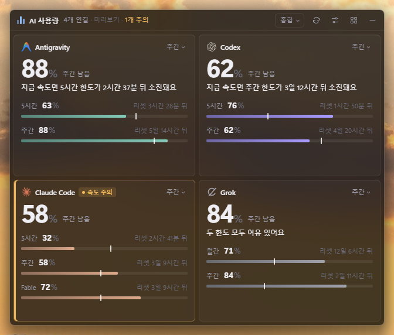
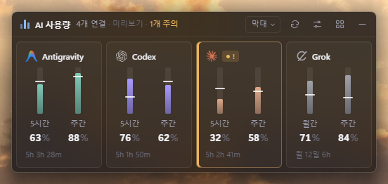
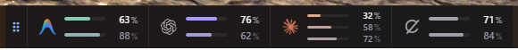
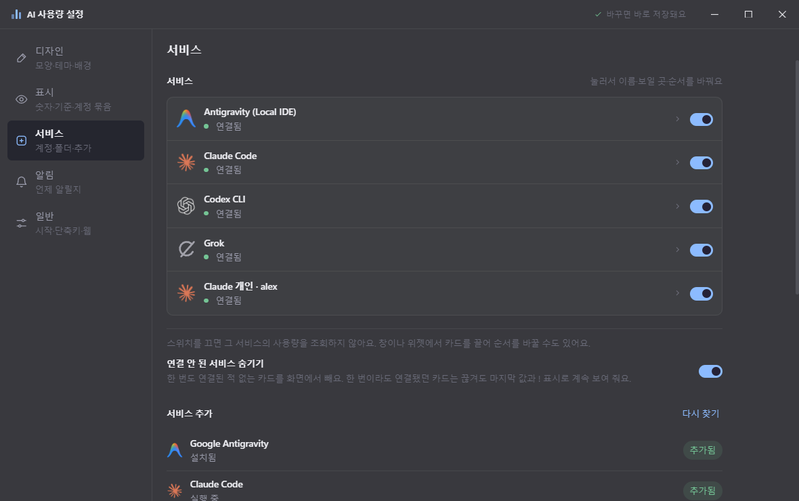

# AI Usage Widget

[한국어](README.md) | **English**

> This repository is a fork of [sallyHADEV/ai-usage-taskbar-widget](https://github.com/sallyHADEV/ai-usage-taskbar-widget), reworked to suit my own needs. The design, settings window, taskbar docking, Claude Team and personal organizations, Grok support, automatic updates and more have been changed or added. Many thanks to the original author.

A desktop app that shows, at a glance on your desktop or taskbar, how much of your Claude, Codex (ChatGPT), Antigravity and Grok usage limits is left. It runs on **Windows (x64, arm64) and Ubuntu (x64, arm64)**. It only reads the sign-ins of the official apps and CLIs you already use, so there's nothing to sign in to and no API key to enter.



New here? Start with the [**user guide**](docs/user-guide.en.md). It walks you through installation, connecting services, reading the display, docking, settings and troubleshooting, in that order.

---

## Features

- **What's left, at a glance**: for each service, see what's left of the 5-hour and weekly limits (plus monthly credits for Grok), the time until each reset, and when you'll run out at your current pace.
- **Pace tick and pace warning**: a white tick on each bar marks where you'd be if you had spread your usage evenly. If you look likely to run out before the reset, the card is highlighted.
- **Six designs, responsive layout**: Overview, Numbers, Bars, Rings, Timeline and Battery. The amount of detail and the layout adapt to the window size, its proportions and the number of services, and no scrollbars ever appear. With a single service the window shrinks to about 170×64.
- **Taskbar docking**: drag the title bar down to the bottom of the screen and a preview appears exactly where it will fit on the taskbar; let go and it docks as a **taskbar dock**. Slide it left and right while docked, or drag it up to turn it back into a window. Click the taskbar dock once to open the **widget** (the same view as the window; close it with the ✕ button or Esc).
- **Hover details**: hover over a bar, tick or card to see what it is, the reset time and anything left out of a small window.
- **Multiple accounts**: for Claude, every sign-in in the CLI and the desktop app is found and you get a card **per organization**, Team and personal. Profiles of the Claude desktop app and Cursor started with another data folder (`--user-data-dir`) are found automatically, whatever launcher or shortcut made them (recognized by the sign-in inside the folder). **Add an account from a folder** works out whether the folder you choose is an app profile, a parent folder holding profiles, or another Codex·Grok·Claude Code login folder (so Claude can show several accounts even on a PC with only the CLI and no desktop app). Model-specific limits on Team plans (such as Fable) are shown too.
- **Which account to use now**: accounts of the same service sit side by side, and the one with the most left (or headroom about to reset) gets a "Pick" label. A used-up card shows when it refills and a button that opens the CLI of the account to switch to, and danger notifications name that account too. **Hide emails** is there for screen sharing.
- **Alerts and history**: Windows notifications for running low, expected to run out, resets and weekly room left over. Usage is recorded and shown in the **Usage stats** window as daily, weekly and monthly bar charts (in % of the weekly limit).
- **API cost estimate**: prices the tokens in the logs Claude Code and Codex leave on this PC at API list prices, showing totals for today, 7 days, this month and 30 days, and cost per model (in the Usage stats window).
- **Adaptive checking**: checks less often while the screen is locked or you're away, and checks again right after a limit resets.
- **Right from the card**: right-click menu (refresh, basis, what to show, order, hide), drag to reorder, number keys 1–5 to resize, `Ctrl+1–6` to switch designs, the title bar menu (☰), and double-click for Focus mode (just that one service).
- **Find a command (Ctrl+K) and Show shortcuts (?)**: type part of a service name, design or setting to focus a service, open a CLI, open a settings section and more. It uses the same command list as the ☰ menu.
- **Web page view**: turn it on in Settings to see your usage in a browser (including phones on the same network). It shows the same cards as the window, view-only; other-device access, port and access password are set in Settings.
- **Korean and English**: the interface is available in English and Korean. By default it follows your Windows display language (English unless it's Korean). Switch any time, without restarting, from **언어 / Language** in the title bar menu (☰) or the tray menu, or in Settings → Display.
- **Handy extras**: remaining % on the tray icon, quiet hours for alerts, settings backup and restore, Click-through lock, global shortcuts (`Ctrl+Alt+U` show, `Ctrl+Alt+L` lock, `Ctrl+Alt+D` design), layout remembered per monitor setup, a subtle warning glow that shifts from yellow to red as you run low, an Always on top pin button, and a widget you can move and resize.
- **Background**: set it like Windows Terminal, with "opacity + acrylic on/off", applied to the window, widget and Settings together. You can pick a background color too.

| Bars | Taskbar docking | Settings |
|---|---|---|
|  |  |  |

## Supported services

| Service | What you need | Limits shown |
|---|---|---|
| Claude | Signed in to the Claude Code CLI (`claude`) or the Claude desktop app | 5-hour, weekly, model-specific weekly (when available) |
| Codex / ChatGPT | Signed in to the Codex CLI, desktop app or VS Code extension | 5-hour, weekly |
| Antigravity | Signed in to the Antigravity CLI (`agy`) | 5-hour, weekly |
| Grok | Signed in to the Grok CLI (`grok`) | Weekly, monthly credits (when available) |
| Cursor | Signed in to the Cursor app | Usage for the current billing cycle (monthly) |
| GitHub Copilot | Copilot signed in to your editor, or the GitHub CLI (`gh`) | Monthly (premium requests, or chat if none) |
| Gemini CLI | Signed in to the Gemini CLI (`gemini`) with a Code Assist Standard or Enterprise account, or a work (Workspace) account | Daily (Pro model) |

You can also add manual accounts where you type in the numbers yourself.

## Installation

### Windows (x64, arm64)

1. Download `AI-Usage-Widget-Setup-x.y.z.exe` from [Releases](https://github.com/ngnearSINE/ai-usage-widget/releases/latest) and run it. A single installer contains both x64 and arm64 and installs the one that fits your PC. It installs into your user folder without admin rights and starts right away. To run it without installing, unzip `AI-Usage-Widget-x.y.z-win-x64.zip` (`-win-arm64.zip` on ARM PCs) and run `AI Usage Widget.exe`.
2. If Windows SmartScreen warns you on first launch, click **More info → Run anyway** (the app has no code-signing certificate).
3. The app finds the sign-ins on this PC and shows them as cards. See the [user guide](docs/user-guide.en.md) for details.

The Windows installer and the Ubuntu AppImage **update automatically**. When a new version comes out, it's downloaded in the background and installed every day at 3 AM (by your PC's clock; you can change this in Settings). If an update is waiting, you can also install it right away with the **Update** button in the title bar (automatic updates can be turned off in About & updates). For the portable zip, download new versions yourself.

Requirements: Windows 11 (22H2 or later recommended). Taskbar docking is only supported with the taskbar at the bottom of the screen.

### Ubuntu (x64, arm64)

Pick the file that fits your PC from [Releases](https://github.com/ngnearSINE/ai-usage-widget/releases/latest). Run `uname -m` in a terminal: `x86_64` means x64 and `aarch64` means arm64.

| Kind | x64 | arm64 |
|---|---|---|
| **AppImage** (recommended, updates automatically) | `AI-Usage-Widget-x.y.z-linux-x86_64.AppImage` | `AI-Usage-Widget-x.y.z-linux-arm64.AppImage` |
| **deb** (install with apt, no automatic updates) | `AI-Usage-Widget-x.y.z-linux-amd64.deb` | `AI-Usage-Widget-x.y.z-linux-arm64.deb` |

#### AppImage

1. Keep it inside your home folder (for example `~/Applications`). Automatic updates replace this file with the new version, so it must be somewhere you can write to.
2. Make it executable and run it.

   ```bash
   mkdir -p ~/Applications && mv ~/Downloads/AI-Usage-Widget-*-linux-*.AppImage ~/Applications/
   chmod +x ~/Applications/AI-Usage-Widget-*-linux-*.AppImage
   ~/Applications/AI-Usage-Widget-*-linux-*.AppImage
   ```

3. If it doesn't start and you get a FUSE error, install `libfuse2` (`libfuse2t64` on Ubuntu 24.04, `libfuse2` on 22.04).

   ```bash
   sudo apt install libfuse2t64
   ```

4. To show it in the app list, create a shortcut (change the file name to the one you downloaded). To start it automatically when you log in, turn on Settings → General → **Start when you log in** in the app.

   ```bash
   cat > ~/.local/share/applications/ai-usage-widget.desktop <<'EOF'
   [Desktop Entry]
   Type=Application
   Name=AI Usage Widget
   Exec=/home/your-user-name/Applications/AI-Usage-Widget-x.y.z-linux-x86_64.AppImage
   Categories=Utility;
   EOF
   ```

#### deb

Once installed, **AI Usage Widget** appears in the app list; from a terminal, run `ai-usage-widget`. To update, download the new deb and install it with the same command.

```bash
sudo apt install ./AI-Usage-Widget-*-linux-*.deb
```

#### Uninstalling

- deb: `sudo apt remove ai-usage-taskbar-widget`
- AppImage: delete the file. If you turned on start at login, also delete `~/.config/autostart/ai-usage-widget.desktop`, and if you made a shortcut, `~/.local/share/applications/ai-usage-widget.desktop`.
- To remove settings and history as well, delete `~/.config/ai-usage-taskbar-widget/`.

#### What's different on Ubuntu

- **No taskbar dock or widget** (they're specific to the Windows taskbar). You use the window and the tray. Acrylic is Windows-only too, so you can only adjust opacity.
- **Claude desktop app accounts** are read using the password stored in the GNOME keyring. You need to be logged in with the keyring unlocked, and `python3` is required (installed by default on Ubuntu Desktop).
- The tray icon appears through Ubuntu's built-in AppIndicator extension. On other desktop environments the tray may not be visible.
- Tested on: Ubuntu 24.04 x64 (GNOME on Xorg) for running, and arm64 for installing and running. Up to 1.5.2 the window couldn't be dragged on Ubuntu; this was fixed in 1.5.3.

## Privacy

- Sign-in information is only read on this PC, and requests go only to each service's usage endpoint. No new sign-ins are created and no usage analytics are collected. **One exception**: if a Claude Code CLI token (valid for 8 hours) or a Grok CLI token (valid for 6 hours) has been expired for 10 minutes and nothing has refreshed it, the app refreshes it the same way that CLI would and saves it back to the CLI's sign-in file (`~/.claude/.credentials.json`, `~/.grok/auth.json`). It never touches a valid token in use, and it won't write if the CLI changed the file in the meantime. When the sign-in period itself ends, sign in again from a terminal with `claude` or `grok login`.
- Only when **Web page view** is on can the usage page be opened from this PC (or the same network). Sign-in information, file paths and the access password are never sent to the page.
- Automatic updates (installer version) only check GitHub Releases for a new version and download it. No usage or sign-in information is sent.
- Settings and history are stored in `%APPDATA%\ai-usage-taskbar-widget\` (`~/.config/ai-usage-taskbar-widget/` on Ubuntu).
- Claude's model-specific limits and the Grok, Cursor, GitHub Copilot and Gemini CLI usage are read in ways that aren't officially documented. If a format changes, only that information disappears and everything else keeps working.
- The **API cost estimate** collects only token counts per date and model from the Claude Code and Codex logs and stores them on this PC (no conversation content). The price list is the one published by LiteLLM, downloaded once a day.

---

## For developers

### Requirements

- Windows 11, Node.js 20 or later (tested with 22)
- `csc.exe` from .NET Framework 4 (included with Windows), used to compile the taskbar helper `native/TaskbarDock.exe`.

### Run and build

Dependencies and build output live in your user cache (`%USERPROFILE%\.cache\ai-usage-widget\<path hash>`), not in the project folder. So even if the project sits in a synced folder such as Dropbox, `node_modules` isn't synced.

```powershell
npm run local           # build and run
npm run local:preview   # run with sample data instead of real accounts (separate settings path)
npm run local:build     # build only
npm run local:package   # make a folder you can run without installing (win-unpacked)
npm run release         # make release builds (see below)
```

If the app is running from the same build cache, quit it from the tray first (the helper program file gets rewritten). To work directly inside the project instead of the cache, run `npm install`, then `npm run build`, `npm start` and `npm test`.

### Publishing a new version (`npm run publish`)

1. Commit your changes to `main`, then run `npm run publish`. It bumps the last digit of the version, commits, tags it `v1.2.3` and pushes.
2. When the tag is pushed, GitHub Actions (`.github/workflows/release.yml`) builds and tests on Windows and uploads the installer, zip and update info (`latest.yml`) to [Releases](https://github.com/ngnearSINE/ai-usage-widget/releases). Your PC doesn't need to stay on.
3. Installed copies check for a new version every 6 hours (and once 30 seconds after starting).

### Making release builds on this PC (`npm run release`)

1. Bumps the last digit of the version in the build cache copy (1.4.1 → 1.4.2).
2. Builds. If the C# compiler's temp file error (`CVT1108`) occurs, it retries automatically.
3. Runs the unit tests. If they fail, no release build is made.
4. Uses `electron-builder` to make the installer (NSIS, per-user install) and the portable zip, keeping **only the latest** in `release/` (excluded from Git).
5. Only when everything succeeds does it bump the version in the project's `package.json` and `package-lock.json`. Include these two files in your commit.

### Structure

| Location | Contents |
|---|---|
| `src/main/` | Electron main process: windows (shared window `surface-window.ts`), docking and dragging, tray, tooltip window, notifications, history |
| `src/renderer/` | Window, widget, taskbar dock and settings screens. Card drawing is in `components/usage-views.ts` |
| `src/services/` | Usage lookups per service (Claude organizations, Codex app-server, Antigravity CLI, Grok), account storage |
| `src/common/` | Pure logic shared by the UI and tests (limit model, layout, alert rules, history) |
| `native/TaskbarDock.cs` | Helper program that handles taskbar docking and sliding, mouse tracking, and keeping window transparency and acrylic. The app starts it once in resident mode (`serve`) and sends it commands |
| `test/` | Unit tests (`node --test`) |
| `docs/` | User guide and screenshots |

### Known limitations

- Taskbar docking and acrylic depend on Windows APIs, so they're Windows-only.
- The interface is available in Korean and English only.
- There's no code signing, so SmartScreen warns on first launch.
