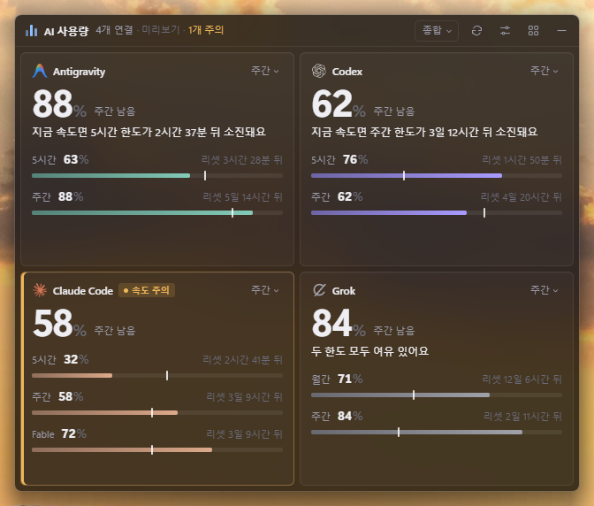
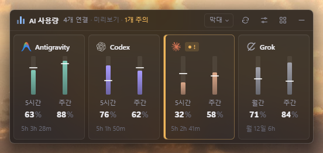
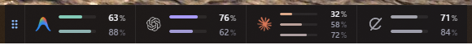
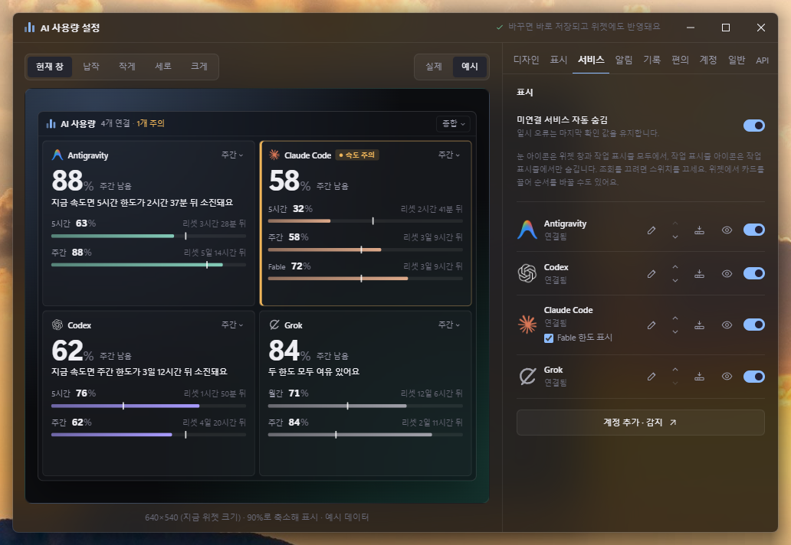

# AI 사용량 위젯 (AI Usage Widget)

**한국어** | [English](README.en.md)

> 이 저장소는 [sallyHADEV/ai-usage-taskbar-widget](https://github.com/sallyHADEV/ai-usage-taskbar-widget)을 fork해서 개인적으로 원하는 대로 고친 버전입니다. 디자인·설정 화면·작업 표시줄 도킹·Claude 팀·개인 조직·Grok 지원·자동 업데이트 등을 바꾸거나 더했습니다. 원본을 만들어 주신 분께 감사드립니다.

Claude, Codex(ChatGPT), Antigravity, Grok의 사용 한도가 얼마나 남았는지 바탕화면이나 작업 표시줄에서 한눈에 보여 주는 데스크톱 위젯입니다. **Windows(x64·arm64)와 Ubuntu(x64·arm64)**에서 동작합니다. 이미 로그인된 공식 앱·CLI의 정보를 읽기만 하므로 따로 로그인하거나 API 키를 넣을 필요가 없습니다.



처음 쓰신다면 [**사용 설명서**](docs/user-guide.md)부터 보세요. 설치, 서비스 연결, 화면 읽는 법, 도킹, 설정, 문제 해결을 순서대로 안내합니다.

---

## 주요 기능

- **한눈에 보는 남은 양**: 서비스마다 5시간·주간(Grok은 월간 크레딧도) 한도의 남은 양, 리셋까지 남은 시간, 지금 속도로 소진될 시점을 보여 줍니다.
- **페이스 눈금과 속도 주의**: 막대 위 흰 눈금이 '고르게 썼다면 지금 남아 있어야 할 양'을 표시합니다. 리셋 전에 바닥날 것 같으면 카드를 강조합니다.
- **디자인 6종과 반응형 배치**: 종합·숫자·막대·원형·타임라인·배터리. 창 크기와 비율, 서비스 수에 맞춰 정보량과 배치를 자동으로 바꾸고 스크롤을 만들지 않습니다. 서비스가 하나면 약 170×64까지 줄어듭니다.
- **작업 표시줄 도킹**: 제목줄을 화면 아래로 끌면 작업 표시줄의 실제 들어갈 자리에 미리보기가 뜨고, 놓으면 붙습니다. 붙은 채로 좌우로 옮기고, 위로 끌어 올리면 다시 창이 됩니다.
- **마우스 설명**: 막대·눈금·카드에 마우스를 올리면 무엇인지와 리셋 시각, 생략된 정보를 보여 줍니다.
- **여러 계정**: Claude는 CLI·데스크톱 앱의 로그인을 모두 찾아 팀·개인 **조직마다** 카드를 만듭니다. Codex·Grok은 다른 로그인 폴더의 계정을 하나 더 추가할 수 있습니다. 팀 요금제의 모델 전용 한도(예: Fable)도 표시합니다.
- **알림과 기록**: 여유 부족, 소진 예상, 리셋, 남는 주간 여유를 Windows 알림으로 알려 주고, 사용량을 30일 동안 기록해 그래프로 보여 줍니다.
- **카드에서 바로**: 우클릭 메뉴(새로고침·기준·보여 줄 정보·순서·숨기기), 끌어서 순서 바꾸기, 숫자키 1~5로 크기 바꾸기, `Ctrl+1~6`으로 디자인 바꾸기, 제목줄 메뉴(☰), 두 번 눌러 집중 모드(그 서비스 하나만).
- **편의 기능**: 트레이 아이콘에 남은 %, 알림 쉬는 시간, 설정 백업·복원, 클릭 통과 잠금, 전역 단축키(`Ctrl+Alt+U` 보이기, `Ctrl+Alt+L` 잠금, `Ctrl+Alt+D` 디자인), 모니터 구성별 배치 기억, 남은 양에 따라 노랑→빨강으로 은은하게 바뀌는 경고 배경, 항상 위 핀 단추, 옮기고 크기를 바꿀 수 있는 작업 표시줄 팝업.
- **배경**: Windows Terminal처럼 '불투명도 + 아크릴 켬/끔'으로 정하고 위젯·팝업·설정 창에 함께 적용합니다.

| 막대 | 작업 표시줄 도킹 | 설정 창 |
|---|---|---|
|  |  |  |

## 지원 서비스

| 서비스 | 필요한 것 | 보여 주는 한도 |
|---|---|---|
| Claude | Claude Code CLI(`claude`) 또는 Claude 데스크톱 앱 로그인 | 5시간, 주간, 모델 전용 주간(있을 때) |
| Codex / ChatGPT | Codex CLI·데스크톱 앱·VS Code 확장 중 하나 로그인 | 5시간, 주간 |
| Antigravity | Antigravity CLI(`agy`) 로그인 | 5시간, 주간 |
| Grok | Grok CLI(`grok`) 로그인 | 주간, 월간 크레딧(있을 때) |

직접 숫자를 넣는 수동 계정도 추가할 수 있습니다.

## 설치

### Windows (x64·arm64)

1. [Releases](https://github.com/ngnearSINE/ai-usage-widget/releases/latest)에서 `AI-Usage-Widget-Setup-x.y.z.exe`를 내려받아 실행합니다. 설치 파일 하나에 x64·arm64가 함께 들어 있어 PC에 맞는 쪽이 설치됩니다. 관리자 권한 없이 사용자 폴더에 설치되고 바로 시작합니다. 설치 없이 쓰려면 `AI-Usage-Widget-x.y.z-win-x64.zip`(ARM PC는 `-win-arm64.zip`)의 압축을 풀고 `AI Usage Widget.exe`를 실행합니다.
2. 처음 실행할 때 Windows SmartScreen 경고가 뜨면 **추가 정보 → 실행**을 누릅니다(코드 서명 인증서가 없기 때문).
3. 위젯이 이 PC의 로그인을 자동으로 찾아 카드를 보여 줍니다. 자세한 사용법은 [사용 설명서](docs/user-guide.md)에 있습니다.

Windows 설치판과 Ubuntu AppImage는 **자동으로 업데이트**됩니다. 새 버전이 나오면 뒤에서 내려받아 두고 매일 새벽 3시(PC 시계 기준, 설정에서 바꿀 수 있음)에 설치합니다. 받아 둔 새 버전이 있으면 제목줄의 **업데이트** 단추로 바로 설치할 수도 있습니다(정보·업데이트 창에서 자동 업데이트를 끌 수 있습니다). 휴대용 zip은 새 버전을 직접 내려받아야 합니다.

요구 사항: Windows 11(22H2 이상 권장). 작업 표시줄 도킹은 화면 아래쪽 작업 표시줄에서만 지원합니다.

### Ubuntu (x64·arm64)

Releases에서 PC에 맞는 파일을 고릅니다(`uname -m`이 `x86_64`면 x64, `aarch64`면 arm64).

- **AppImage(권장, 자동 업데이트)**: `AI-Usage-Widget-x.y.z-linux-x86_64.AppImage`(ARM은 `-linux-arm64.AppImage`)를 내려받아 실행 권한을 주고 실행합니다.

  ```bash
  chmod +x AI-Usage-Widget-*-linux-*.AppImage && ./AI-Usage-Widget-*-linux-*.AppImage
  ```

  AppImage는 `libfuse2`가 필요합니다. Ubuntu 24.04에서 실행되지 않으면 `sudo apt install libfuse2t64`(22.04는 `libfuse2`)를 설치하세요.
- **deb(apt 설치)**: `AI-Usage-Widget-x.y.z-linux-amd64.deb`(ARM은 `-linux-arm64.deb`)를 내려받아 설치합니다. 자동 업데이트는 되지 않으니 새 버전 deb을 받아 다시 설치합니다.

  ```bash
  sudo apt install ./AI-Usage-Widget-*-linux-*.deb
  ```

Ubuntu에서 다른 점:
- **작업 표시줄 도킹과 상세 팝업은 없습니다**(Windows 작업 표시줄 전용). 위젯 창과 트레이로 씁니다. 아크릴 배경도 Windows 전용이라 불투명도만 조절합니다.
- **Claude 데스크톱 앱 계정**은 GNOME 키링에 저장된 암호로 읽습니다. 로그인해 키링이 열려 있어야 하고 `python3`가 필요합니다(Ubuntu 데스크톱 기본 설치).
- 트레이 아이콘은 Ubuntu 기본 AppIndicator 확장으로 보입니다. 다른 데스크톱 환경에서는 트레이가 보이지 않을 수 있습니다.
- 실제로 시험한 환경은 Ubuntu 24.04(x64, GNOME Xorg)입니다. arm64는 패키지 빌드만 확인했습니다.

## 개인정보

- 로그인 정보는 이 PC 안에서 읽기만 하고, 각 서비스의 사용량 조회 주소로만 요청합니다. 로그인 정보를 만들거나 바꾸지 않으며, 사용 통계를 수집하지 않습니다.
- 사용자가 설정의 일반 탭 → 고급 → 외부 디스플레이로 보내기를 직접 켠 경우에만 지정한 주소로 사용량 숫자를 보냅니다.
- 자동 업데이트(설치판)는 GitHub Releases에 새 버전이 있는지만 확인하고 내려받습니다. 사용량·로그인 정보는 보내지 않습니다.
- 설정·기록은 `%APPDATA%\ai-usage-taskbar-widget\`(Ubuntu는 `~/.config/ai-usage-taskbar-widget/`)에 저장합니다.
- Claude 모델 전용 한도와 Grok 사용량은 공식 문서에 없는 조회 방식입니다. 형식이 바뀌면 그 정보만 빠지고 나머지는 계속 표시됩니다.

---

## 개발자 안내

### 준비

- Windows 11, Node.js 20 이상(검증: 22)
- .NET Framework 4의 `csc.exe`(Windows 기본 포함) — 작업 표시줄 보조 프로그램 `native/TaskbarDock.exe`를 컴파일합니다.

### 실행·빌드

의존성과 빌드 결과는 프로젝트 폴더가 아닌 사용자 캐시(`%USERPROFILE%\.cache\ai-usage-widget\<경로 해시>`)에 둡니다. 프로젝트가 Dropbox 같은 동기화 폴더에 있어도 `node_modules`가 동기화되지 않습니다.

```powershell
npm run local           # 빌드하고 실행
npm run local:preview   # 실제 계정 조회 없이 예시 데이터로 실행(설정도 별도 경로)
npm run local:build     # 빌드만
npm run local:package   # 설치 없이 실행하는 폴더(win-unpacked) 만들기
npm run release         # 배포본 만들기(아래 참고)
```

같은 빌드 캐시에서 실행 중인 위젯이 있으면 먼저 트레이에서 종료하세요(보조 프로그램 파일을 다시 쓰기 때문). 캐시를 쓰지 않고 프로젝트 안에서 직접 다루려면 `npm install` 뒤 `npm run build`, `npm start`, `npm test`를 씁니다.

### 새 버전 배포 (`npm run publish`)

1. `master`에 변경을 커밋한 뒤 `npm run publish`를 실행합니다. 버전 마지막 자리를 1 올려 커밋하고 `v1.2.3` 태그를 붙여 올립니다.
2. 태그가 올라가면 GitHub Actions(`.github/workflows/release.yml`)가 Windows에서 빌드·테스트하고, 설치 파일·zip·업데이트 정보(`latest.yml`)를 [Releases](https://github.com/ngnearSINE/ai-usage-widget/releases)에 올립니다. PC를 켜 둘 필요가 없습니다.
3. 설치해 쓰는 앱은 6시간마다(시작 30초 뒤 한 번) 새 버전을 확인합니다.

### 이 PC에서 배포본 만들기 (`npm run release`)

1. 빌드 캐시 사본에서 버전 마지막 자리를 1 올립니다(1.4.1 → 1.4.2).
2. 빌드합니다. C# 컴파일 임시 파일 오류(`CVT1108`)가 나면 자동으로 다시 시도합니다.
3. 단위 테스트를 돌립니다. 실패하면 배포본을 만들지 않습니다.
4. `electron-builder`로 설치 파일(NSIS, 사용자별 설치)과 휴대용 zip을 만들어 `release/`에 **최신본만** 둡니다(Git 제외).
5. 모두 성공했을 때만 프로젝트의 `package.json`·`package-lock.json` 버전을 올립니다. 이 두 파일은 커밋할 때 함께 넣으세요.

### 구조

| 위치 | 내용 |
|---|---|
| `src/main/` | Electron 메인 프로세스. 창(공통 창 `surface-window.ts`), 도킹·끌기, 트레이, 설명 창, 알림, 기록 |
| `src/renderer/` | 위젯·설정·팝업 화면. 카드 그리기는 `components/usage-views.ts` |
| `src/services/` | 서비스별 사용량 조회(Claude 조직, Codex app-server, Antigravity CLI, Grok), 계정 저장 |
| `src/common/` | 화면과 테스트가 함께 쓰는 순수 계산(한도 모델, 배치, 알림 규칙, 기록) |
| `native/TaskbarDock.cs` | 작업 표시줄 도킹·좌우 이동, 마우스 감시, 창 투명도·아크릴 유지를 맡는 보조 프로그램. 앱이 상주 모드(`serve`)로 한 번 띄워 명령을 보냅니다 |
| `test/` | 단위 테스트(`node --test`) |
| `docs/` | 사용 설명서와 화면 사진 |

### 알려진 한계

- Windows 전용입니다. 작업 표시줄 도킹과 아크릴은 Windows API에 의존합니다.
- 화면 문구는 대부분 한국어입니다. 영어 번역은 일부 항목에만 있습니다.
- 코드 서명이 없어 처음 실행할 때 SmartScreen 경고가 뜹니다.
