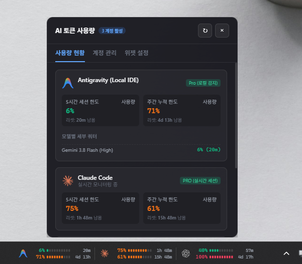
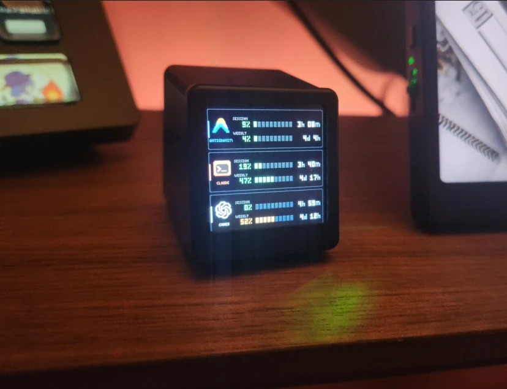

# Taskbar AI Token Usage Widget (작업표시줄 AI 토큰 사용량 모니터 위젯)

**한국어** | [English](README.en.md)

Windows 바탕화면에 자유롭게 배치하거나 작업표시줄에 도킹해 AI 계정(Antigravity, Claude, Codex, 커스텀 AI)의 세션·주간 사용량과 리셋 시간을 확인하는 데스크톱 위젯입니다.



---

## 주요 기능 및 사양 구현 현황

1. **자유 창과 작업표시줄 도킹**:
   - **자유 창 (기본값)**: 이동·크기 조절과 위치·크기 복원을 제공합니다. '항상 위에 표시' 옵션을 선택할 수 있습니다.
   - **도킹**: 화면 아래로 끌고 놓으면 작업표시줄(`Shell_TrayWnd`)의 자식 창으로 전환됩니다. 작업표시줄 높이를 채우며 끌어내면 자유 창으로 복원됩니다.
   - 포인터 옆 안내와 반투명 도킹 미리보기를 제공합니다.
   - 아크릴·투명·단색 소재를 선택할 수 있고 둥근 모서리를 실제 창 영역에도 적용합니다.

2. **반응형 카드와 6종 막대 디자인**:
   - 풍부·중간·간결·최소 정보 단계와 단계 내부 비례 조절을 결합합니다. 가로·세로 크기와 서비스 수에 맞춰 스크롤 없이 재배열합니다.
   - 최소 가로형은 작은 로고·막대 2개·퍼센트 2개, 작은 정사각형은 로고·퍼센트 2개만 표시합니다.
   - 실크·오로라·네온·세그먼트·모노·스펙트럼, 선택 가능한 애니메이션, 테마·강조색·글자 크기·간격·표시 정보를 제공합니다.

3. **AI 아이콘 2종 모드**:
   - **오리지널 컬러**: 브랜드 고유 컬러(Claude 오렌지, Gemini 민트/블루, Mistral 블루, Grok 퍼플 등).
   - **채도 없음 (모노크롬)**: 미니멀한 흑백/그레이스케일 작업표시줄 스타일.

4. **사용량에 따른 색상 변화**:
   - 3단계 임계값 색상 동적 전환 (0~59% 정상 그린 &rarr; 60~84% 주의 오렌지 &rarr; 85~100% 경고 레드).

5. **계정 기반 인증 & 다중 계정 무제한 관리**:
   - **Antigravity 연동 (무인증)**: 이미 로그인된 `agy` CLI를 브리지로 사용합니다. `agy -p "/usage" --output-format json`(읽기 전용, 쿼터 소비 없음)의 결과를 파싱하므로 앱이 계정·토큰·키를 다루지 않습니다. `agy` CLI 1.1.11 이상이 필요하며, CLI가 없거나 응답이 없으면 마지막 실측값 또는 오류 상태를 표시합니다.
   - **Claude 연동**: Claude 계정은 하나만 표시합니다. CLI 로그인으로 실시간 조회를 먼저 시도하고, 실패하면 Windows 데스크톱 앱의 기존 로그인 세션으로 5시간·7일 사용률과 리셋 시간을 조회합니다. 추가 로그인이나 앱 종료는 필요하지 않습니다. 일반 설치와 Microsoft Store 데이터 경로를 자동 탐색하고, `config.json`의 OAuth V2 캐시와 `Local State`의 암호화 키를 읽습니다. 토큰·계정 ID·사용자 경로는 하드코딩하거나 로그에 남기지 않습니다. 세션 조회 실패 시 `plan-usage-history.json` 기록으로 폴백하며, 한 시간 이상 지난 기록은 오래됨으로, 기록에 없는 리셋 시간은 `--`로 표시합니다.
   - **커스텀/목 계정 지원**: 원하는 만큼 계정 추가/비활성화 토글/삭제 가능.

6. **클릭 시 디테일 팝업창 (모션 애니메이션)**:
   - 도킹 위젯·트레이 아이콘 또는 자유 창의 고급 설정 버튼으로 상세 팝업을 엽니다.
   - 설정에서 '더블 클릭으로 팝업 열기'를 켜면 두 번 클릭해야만 열려, 실수로 팝업이 뜨는 것을 막을 수 있습니다.
   - 사용량, 계정, 설정, API 탭으로 구성되며 실시간 카운트다운, 계정 관리 및 위젯 설정을 제공합니다.

7. **경량성 및 사용자 지정 주기**:
   - CSS와 DOM 기반으로 표시하며 시스템의 동작 줄이기 설정을 따릅니다.
   - 업데이트 주기 사용자 선택 (15초, 30초, 1분, 2분, 5분).

8. **윈도우 시작 시 자동 실행 (Auto-Launch)**:
   - 작업표시줄 트레이 메뉴 및 위젯 설정 탭에서 원클릭으로 윈도우 시작 시 자동 실행 설정/해제 지원.

9. **사용량 API 푸시 & 외부 디스플레이 연동**:
   - 설정의 **API** 탭에서 푸시를 켜고 엔드포인트 URL(기본값 `http://localhost:8080/api/usage`)과 화면 번호를 지정하면, 쿼터를 갱신할 때마다 사용량 데이터를 HTTP POST로 전송합니다.
   - GeekMagic SmallTV(ESP8266)용 커스텀 펌웨어를 함께 제공하여, 책상 위 작은 디스플레이에 세션·주간 사용량과 리셋 카운트다운을 띄울 수 있습니다. 설치 방법은 [`firmware/README.md`](firmware/README.md)를 참고하세요.

   

---

## 설치 및 실행 방법

### 로컬 전용 실행 · 자유 배치 화면

이 프로젝트는 Git 원격 저장소 연결을 해제한 로컬 개발본입니다.

```powershell
# 프로젝트 폴더에서 실행. 의존성과 빌드 결과는 Dropbox 밖 로컬 캐시에 저장합니다.
npm run local

# 실제 계정 조회 없이 합성 데이터로 외형을 확인합니다.
npm run local:preview

# 실행하지 않고 빌드만 하거나 Windows 실행 폴더를 만듭니다.
npm run local:build
npm run local:package
```

- 상단 손잡이로 창을 이동하고 가장자리·모서리로 크기를 조절합니다. 크기와 위치는 재실행 후 복원됩니다.
- 손잡이를 화면 아래로 끌고 놓으면 작업표시줄에 도킹됩니다. 도킹된 막대를 끌면 이전 크기의 자유 창으로 돌아옵니다.
- 카드 배치와 정보량은 창의 가로·세로 크기, 비율, 서비스 수에 맞춰 자동 전환됩니다. 메인 영역에는 스크롤을 만들지 않습니다. 아주 작은 창에 서비스가 많으면 페이지로 나눕니다.
- 디자인 패널에서 밝은·어두운·시스템 테마, 6종 막대 프리셋, 강조색, 애니메이션, 글자 크기, 간격, 불투명도와 표시 정보를 조절합니다.
- 배경 소재는 아크릴·투명·단색 중 선택합니다. 네이티브 아크릴은 Windows 11 22H2 이상에서 지원되며 OS의 투명 효과 설정에 따라 달라집니다. 미지원 환경에서는 반투명 배경을 사용합니다.
- 카드 손잡이를 드래그하거나 `Alt+방향키`, 서비스 관리의 순서 버튼으로 정렬합니다. 최소 카드에서는 서비스 관리에서 순서를 바꿀 수 있습니다.
- 미연결 서비스 자동 숨김과 계정별 수동 숨김을 제공합니다. 이미 확인한 서비스의 일시 오류에는 마지막 값과 지연 상태를 표시합니다.
- 같은 로컬 빌드 캐시에서 실행 중인 앱이 있으면 트레이에서 종료한 뒤 다시 빌드해 주세요. 미리보기는 실제 앱과 다른 설정 경로를 사용합니다.

디자인의 비교 근거와 참고 자료는 [디자인 검토](.agents/design-notes.md)에 정리했습니다.

### 1. 빌드된 배포판 다운로드 (일반 사용자)
GitHub 저장소 우측의 **Releases** 탭에서 최신 버전의 `AI-Usage-Widget-vX.X.X-win-x64.zip`을 다운로드하여 압축을 풀고 `AI Usage Widget.exe`를 실행하세요.

### 2. 소스 코드 빌드 및 실행 (개발자)

#### 의존성 설치
```bash
npm install
```

#### 환경변수 (선택 사항)
Codex 실행 파일이 기본 경로에 없다면 시스템 환경변수 `CODEX_EXECUTABLE`에 경로를 지정합니다. (`.env.example` 참고)

#### 빌드 및 실행
```bash
# 네이티브 C# 도우미(TaskbarDock.exe) 컴파일 + TypeScript + Vite 번들링
npm run build

# (선택) 네이티브 도우미만 다시 컴파일 (.NET Framework 4 csc.exe 사용)
npm run build:native

# 앱 실행
npm start

# 테스트
npm test
```

#### 배포 패키징
```bash
# Windows 무설치(디렉터리형) 배포 패키지 생성
npm run dist

# 배포용 zip 압축 패키지 생성 (Releases에 올리는 형식)
npm run dist:zip
```

