# AI Usage Widget user guide

AI Usage Widget shows how much of your Claude, Codex (ChatGPT), Antigravity and Grok usage limits (5-hour, weekly, monthly and so on) is left, right on your Windows desktop or taskbar. This guide walks first-time users through everything from installation to every feature.

> All screenshots use sample data instead of real accounts. They show the Korean interface; the English interface has the same layout.

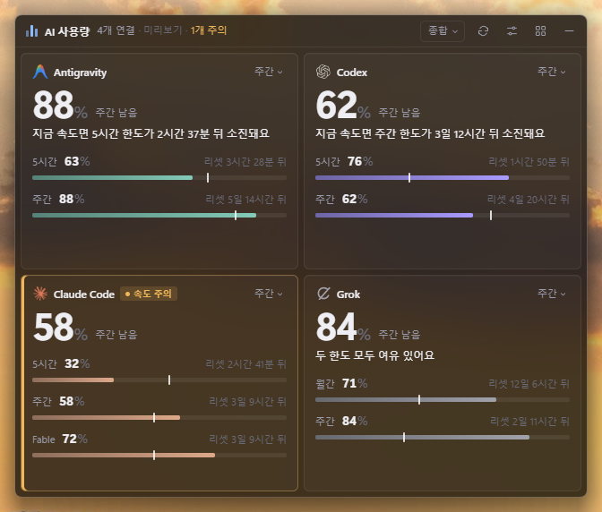

## Contents

1. [What you need](#1-what-you-need)
2. [Installation](#2-installation)
3. [First launch](#3-first-launch)
4. [Connecting services](#4-connecting-services)
5. [Reading the display](#5-reading-the-display)
6. [Working with the window](#6-working-with-the-window)
7. [Docking to the taskbar](#7-docking-to-the-taskbar)
8. [Settings](#8-settings)
9. [Tray icon and shortcuts](#9-tray-icon-and-shortcuts)
10. [Alerts and usage history](#10-alerts-and-usage-history)
11. [Privacy and data locations](#11-privacy-and-data-locations)
12. [Troubleshooting](#12-troubleshooting)
13. [Updating and uninstalling](#13-updating-and-uninstalling)

---

## 1. What you need

- **Windows 11** (x64 or arm64; 22H2 or later for the blurred acrylic background). On Windows 10, taskbar docking and acrylic may not work properly.
- Or **Ubuntu** (x64 or arm64, tested on 24.04). On Ubuntu there is no taskbar dock, widget or acrylic; you use the window and the tray icon. See [Using it on Ubuntu](#using-it-on-ubuntu).
- You need to be **signed in to the official app or CLI** of each service you want to track. The app has no sign-in screen of its own; it only reads the sign-in of apps that are already signed in. See [4. Connecting services](#4-connecting-services) for what each service needs.

## 2. Installation

Download from [Releases](https://github.com/ngnearSINE/ai-usage-widget/releases/latest). There are two kinds of download; pick just one.

| File | Description |
|---|---|
| `AI-Usage-Widget-Setup-x.y.z.exe` | **Installer (recommended).** Installs into your user folder (`%LOCALAPPDATA%\Programs\AI Usage Widget`) without admin rights and adds a Start menu shortcut and an uninstaller. The app starts as soon as installation finishes. |
| `AI-Usage-Widget-x.y.z-win-x64.zip` `AI-Usage-Widget-x.y.z-win-arm64.zip` | **Portable.** Unzip the one that matches your PC (usually x64; arm64 for ARM laptops) into any folder and run `AI Usage Widget.exe`. Nothing to install or uninstall. |

The installer contains both x64 and arm64 and installs the right one for your PC automatically.

### If you see "Windows protected your PC"

The app has no code-signing certificate, so Windows SmartScreen may warn you the first time you run it. Click **More info → Run anyway** to open it. Once allowed, the warning won't appear again.

### Using it on Ubuntu

If `uname -m` prints `x86_64`, pick the x64 file (`x86_64` or `amd64` in the file name); if it prints `aarch64`, pick the arm64 file.

| File | Description |
|---|---|
| `AI-Usage-Widget-x.y.z-linux-x86_64.AppImage` `AI-Usage-Widget-x.y.z-linux-arm64.AppImage` | **Recommended. Updates automatically.** Download it, make it executable with `chmod +x file-name`, then run it. If it won't start, install `sudo apt install libfuse2t64` (`libfuse2` on 22.04). |
| `AI-Usage-Widget-x.y.z-linux-amd64.deb` `AI-Usage-Widget-x.y.z-linux-arm64.deb` | Install with `sudo apt install ./file-name.deb` and launch **AI Usage Widget** from the app list. Does not update automatically. |

Differences from Windows:
- **No taskbar dock or widget.** You use the window, and show or hide it from the tray icon menu (Ubuntu's built-in AppIndicator extension).
- **No acrylic background**; you can only adjust opacity.
- **Claude desktop app accounts** are read using the password stored in the GNOME keyring. You need to be logged in with the keyring unlocked, and `python3` is required (installed by default on Ubuntu Desktop).
- **Start with Windows** works as "start when you log in" on Ubuntu (`~/.config/autostart`).
- Settings and history are stored in `~/.config/ai-usage-taskbar-widget/`.
- Automatic updates replace the AppImage file with the new version, so keep it inside your home folder (for example `~/Applications`). How to add it to the app list is in the README's install section.

## 3. First launch

- A window appears near the middle of the screen, and an icon appears in the notification area (tray) at the right end of the taskbar.
- The app finds the services you're signed in to on this PC and shows each one as a card. For the first few seconds, cards may show "Checking".
- By default the app **starts automatically with Windows**. If you don't want that, turn off "Start with Windows" in the tray menu.
- Instead of a close button there is `—` (**Hide to tray**). To quit completely, choose **Quit** from the tray icon menu.

## 4. Connecting services

The app **only reads the sign-in information that each service's official app or CLI has left on this PC**. It never creates new sign-ins. **One exception**: if a Claude Code CLI token (valid for 8 hours) or a Grok CLI token (valid for 6 hours) has been expired for 10 minutes and nothing has refreshed it, the app refreshes it the same way that CLI would and saves it back to the CLI's sign-in file (`~/.claude/.credentials.json`, `~/.grok/auth.json`). It never touches a valid token in use, and it won't write if the CLI changed the file in the meantime. When the sign-in period itself ends, sign in again from a terminal with `claude` or `grok login`.

| Service | What you need | Limits shown |
|---|---|---|
| **Claude** | Signed in to the Claude Code CLI (`claude`), the Claude desktop app, or both | 5-hour, weekly, model-specific weekly limit (for example Fable on Team plans) |
| **Codex / ChatGPT** | Signed in to the Codex CLI, the Codex desktop app, or the ChatGPT extension for VS Code or Windsurf | 5-hour, weekly (weekly only on some plans) |
| **Antigravity** | Antigravity CLI (`agy`) installed and signed in | 5-hour, weekly |
| **Grok** | Signed in to the Grok CLI (`grok`) | Weekly, monthly credits (on plans that have them) |
| **Cursor** | Signed in to the Cursor app | Usage for the current billing cycle (monthly), plus any extra usage spend |
| **GitHub Copilot** | Copilot signed in to your editor (VS Code and so on), or else the GitHub CLI (`gh auth login`) | Monthly: premium requests (chat on the Free plan) |
| **Gemini CLI** | Signed in to the Gemini CLI (`gemini`) | Daily: remaining Pro model usage (Flash if there is no Pro) |

Cursor, GitHub Copilot and Gemini CLI don't get a card automatically. If you're signed in, they show up under Settings → Services → **Add service**; click **Add**. Since June 18, 2026, Google no longer lets personal accounts (including AI Pro and Ultra) use the Gemini CLI, so limits only appear for work (Workspace), Code Assist Standard and Enterprise accounts. With a personal account, check the Antigravity card instead.

### Multiple Claude Team and personal accounts

With Claude, one email can belong to several **organizations** (Team, personal), and each organization has its own limits. The app finds every sign-in in the CLI and the desktop app and makes one card per organization.

- Cards are named like "Claude Team · organization name" or "Claude personal · start of your email". You can rename one in the **Services** tab of Settings by clicking that service.
- Once you remove an organization's card, it won't come back on its own. To see it again, use **Advanced → Restore the default service list** in the Services tab.

### Good to know

- **A second account (Codex, Grok, Claude)**: sign in to it in a different folder from your usual account (in Command Prompt, run `set CODEX_HOME=folder` then `codex login`; for Grok, `set GROK_HOME=folder` then `grok login`; for Claude, `set CLAUDE_CONFIG_DIR=folder` then `claude` and sign in), then choose that folder under Settings → Services → **Add an account from another login folder**. Antigravity can't keep sign-ins in separate folders, so it isn't supported.
- Organizations connected only through the **Claude Code CLI** lose their sign-in if you don't use the CLI for a few hours. When a card says the "CLI sign-in … expired", run `claude` once in a terminal. Until then the card keeps showing the last value as "Update delayed".
- **Grok** sign-in tokens expire every few hours. When the card shows an "expired" notice, run `grok` once in a terminal to refresh it.
- Cards for **Claude** organizations you don't use in the desktop app can turn "Update delayed" after a long while. Switch to that organization once in the app and it comes back.
- If the Codex executable can't be found, set the environment variable `CODEX_EXECUTABLE` to the path of `codex.exe`.

## 5. Reading the display

### Cards

- **Big number**: what's left of the main limit (weekly by default). Click `Weekly ▾` at the top right of a card to choose 5-hour, weekly, or whichever is tighter.
- **Bar**: the filled length is what's left.
- **White tick (pace)**: where you'd be now if you spread your usage evenly over the reset period. If the end of the bar is **right** of the tick, you have room to spare; if it's **left**, you're using it up fast.
- **Bar color by usage**: the color of the bar and the % number changes with what's left. In the gradient strip under Settings → Display, you set **color stops** like a PowerPoint gradient: where each one sits (remaining %) and its color (service color, orange, red or a custom color). Drag a stop to move it; click an empty spot on the strip to add one (up to 8; delete with the trash button). By default it's the service color down to 50%, orange at 20%, and red below 10%. **Smooth** (default) blends between stops; **Step** switches to a stop's color the moment the remaining amount reaches it. For the number, the "service color" slot means the normal text color (matching the dark or light theme). It applies the same way to every design (rings, battery and so on) and to the taskbar dock. Each service's normal color is set in the Services tab: service color, green or a custom color.
- **Orange border and "Pace warning"**: the card is below the warning level, or at the current rate it looks like it will run out before the reset.
- On small cards, a **thin secondary bar** under the main bar shows the other limit (usually 5-hour).

### Hover for details

Hover over a bar, tick or card to see what it is, what's left, how long until the reset and when exactly, and when it's expected to run out. Anything left out of a small window shows up here too.

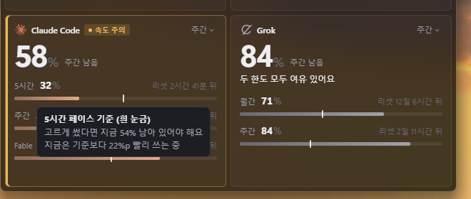

### Six designs

Change the design from the menu (☰) in the window or widget title bar, or in Settings.

| Design | What it shows |
|---|---|
| Overview | Scales from a big number up to a status line, both limit bars and a 24-hour trend line, depending on size |
| Numbers | Mainly big numbers |
| Bars | A bar per limit with the pace tick |
| Rings | Outer ring weekly, inner ring 5-hour |
| Timeline | Time elapsed and amount left side by side |
| Battery | Room left, counted in cells |

| Bars | Rings | Timeline |
|---|---|---|
| 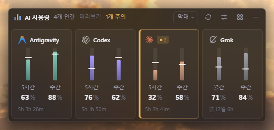 | 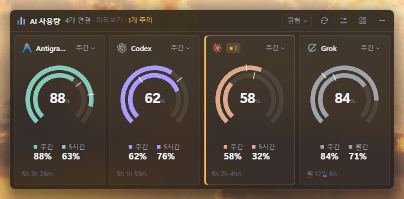 | 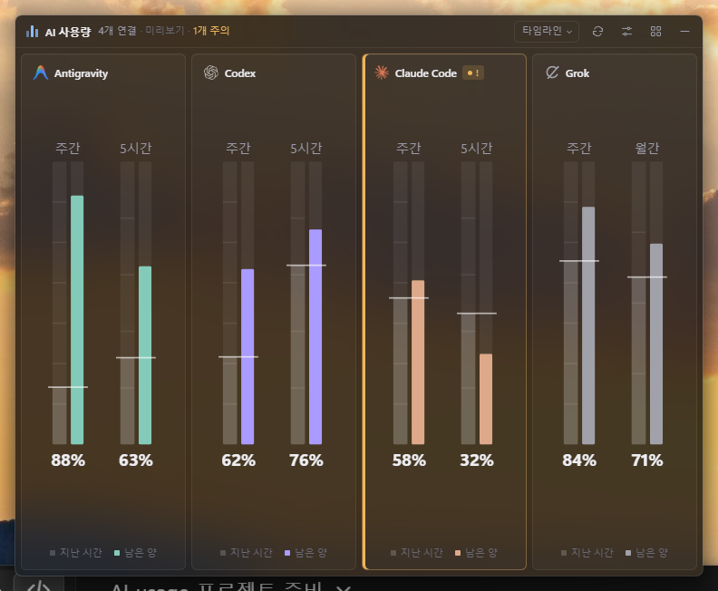 |

## 6. Working with the window

- **Move**: drag the title bar.
- **Resize**: drag an edge or corner. Card layout and the amount of detail adjust to the size automatically, and no scrollbars appear (if it's too small, cards are split into pages).
- **Really small**: with a single service you can shrink the window to about 170×64. When the window is narrow or short the title bar hides; **hover over the top edge of the window** to bring it back.
- **Card order**: with only one card (including Focus mode), dragging the card moves the whole window, just like the title bar. With several cards, press and drag a card and the others move aside to show where it will go; let go and it lands there. You can also use **Move forward / Move back** in the right-click menu, or Settings → Services. You can't reorder while "Put services with less room first" is on. Turn on **Lock card positions** in a card's right-click menu or the title bar menu (☰) and dragging a card moves the whole window instead of reordering (off by default).
- **Open the CLI or app directly**: **Ctrl+double-click** a card to run that service's CLI (claude, codex, grok, agy) in your default terminal; **Shift+double-click** opens its desktop app (Claude, ChatGPT/Codex, Grok and so on). "Open CLI" and "Open app" in the right-click menu do the same. If it can't be found on this PC the menu item is greyed out; in **Settings → Services**, expand that service and use "Choose…" to point at the executable or a shortcut ("Automatic" goes back to finding it automatically). In the same place, **CLI start folder** sets the folder the CLI opens in (your home folder by default; "Home folder" resets it).
- **Right-click menu**: right-click a card for Refresh, the official usage page, the big-number basis, what to show (for that card only), reordering, hiding, and service settings.
- **Number keys 1–5**: resize the window (or widget) in one step, from very small (1) to very large (5).
- **Ctrl+1–6**: change the design (1 Overview, 2 Numbers, 3 Bars, 4 Rings, 5 Timeline, 6 Battery).
- **`** (the key left of 1): turns Always hide title bar on and off. **~** (Shift+`): turns Lock card positions on and off.
- **Title bar**: the current time is shown in the middle (preview builds add a label, as in `13:38 (Preview)`, and it hides if the window is too narrow and it would overlap the text on the left). On the left you'll see how many services are connected and how many need attention; hover over the refresh button for the last and next update times. The buttons on the right are pin, refresh, settings, menu and hide, in that order.
- **Menu (☰) button**: to the right of the settings button in the title bar. Right-clicking anywhere on the title bar opens the same menu right there. It has the design switcher, **Always on top**, **Lock card positions**, **Always hide title bar**, **Language**, Settings, Usage stats, About & updates, Hide to tray and Quit.
- **Snap to screen edges** (on by default, Settings → Display → Window): drag the window or widget within 12 px of a screen edge and it snaps there like a magnet. Horizontal and vertical are checked separately, so it snaps into corners too, and at the bottom it snaps just above the taskbar. Keep dragging and it comes away right away; keep going down into the taskbar and it docks as a taskbar dock, as before. It doesn't snap at the border between two monitors, so moving across monitors stays easy.
- **Always hide title bar** (off by default): hides the title bar whatever the window size, and only shows it on top of the cards when you hover over the top edge. The cards get that much more room.
- **Focus mode**: double-click a card, or choose **Focus mode** at the top of its right-click menu, to show only that service (in the window, the taskbar dock and the widget). It counts as a single card, so you can shrink the window down to one card. The title bar only appears when you hover over the top edge. Leave Focus mode with Esc (in the widget, Esc closes the widget), the **Focus** chip in the title bar, or another double-click. The app always starts with Focus mode off.
- **Always on top pin**: the pin button in the title bar turns Always on top on and off (on by default).
- **Warning glow** (background tint): the card background is gently tinted following the same color stops as the bar. The "service color" slot is transparent, so nothing is tinted while you have plenty left. Under "Bar color by usage" in Settings → Display, you can turn it off or set the **Intensity** (0–100% slider, default 30%; higher is stronger, and 100% is about three times the default), **Spread** (0–100%, default 30%; higher spreads further from the strongest spot and lays a faint tint over the whole card) and **Strongest at** (edge, center, one side). Choosing "one side" shows a card-shaped picker where you choose top, bottom, left, right or one of the four corners. **Reset to defaults** brings Intensity, Spread and Strongest at back to 30%, 30% and edge.
- **Official usage page**: open it from a card's right-click menu (Claude, Codex, Grok).
- **Refresh**: the ⟳ button in the title bar, or "Refresh now" in the tray menu. Usage is checked every minute by default (15 seconds to 5 minutes in the General tab of Settings).

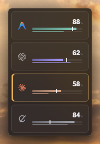

## 7. Docking to the taskbar

1. Grab the window's title bar and drag it **onto the taskbar at the very bottom of the screen**.
2. A **preview of the taskbar dock** (with an accent-colored border) appears exactly where it will go on the taskbar.
3. Let go and the window shrinks into that spot and docks. This strip attached to the taskbar is called the **taskbar dock**.

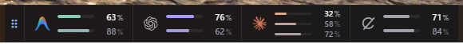

- **Dragging it while docked** moves it only left and right within the taskbar, and it remembers where you leave it.
- **Drag it up more than 40 px** and it becomes a full-size window again.
- Click the taskbar dock once to open the **widget** in front of everything. **Double-click** it to turn on Focus mode, showing just that card while staying docked; double-click again to turn it off (it never covers the clock, even when it gets wider). The widget is the same as the window: same design, card layout, title bar buttons and menu; drag cards to reorder them, and with a single card (including Focus mode) drag the card to move the widget. There are only two differences: the top-right button is **Close** (✕) instead of Hide to tray, and pressing **Esc** closes the widget. Drag its title bar to move it and its edges to resize it, and it remembers that position and size.
- It stops short of the clock and notification area so it never covers them. If you drop it over pinned app icons, it covers those icons.
- You can also dock it with the "Dock to taskbar" button in the **Display** tab of Settings.
- If you only want some services on the taskbar, click the service in the Services tab and set **Show in → Window and widget only** (it still shows in the window and the widget).

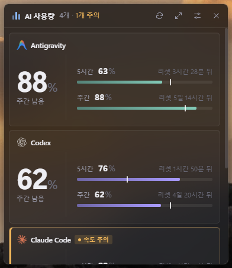

## 8. Settings

Open Settings with the settings button (slider icon) in the window or widget title bar, or **Settings** in the tray menu. It opens on the tab you last used. Changes are saved immediately and applied to the window and widget. On the left is a preview with your current settings, where you can switch the size (current window, flat, small, tall, large) and the data (real, sample).

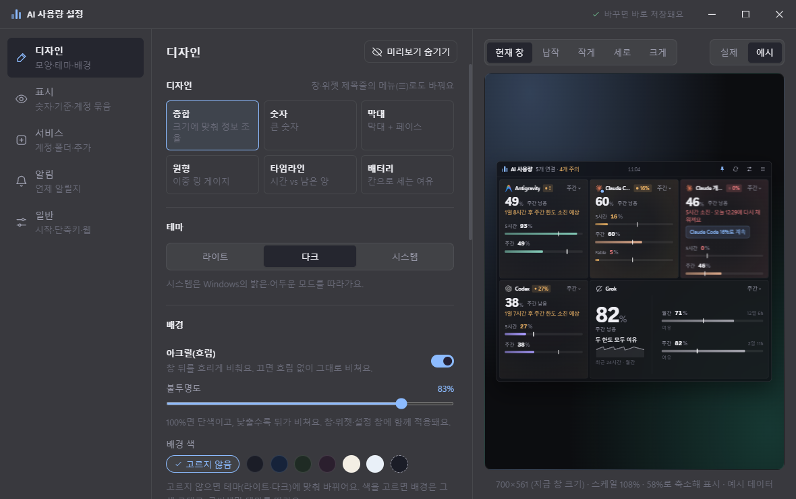

| Tab | What it does |
|---|---|
| **Design** | Six designs, theme (light, dark, system), **background** (acrylic on/off + opacity), bar color, accent color, service icons (brand color or single color), scale and card spacing, motion |
| **Display** | **Language**, big-number basis, warning and danger levels (remaining %), **Bar color by usage** (switch next to the heading turns it on and off; step or smooth; color-stop gradient; background tint using the same stops), put services with less room first, **What to show table** (show as used, projected time and reset time per service; the top row sets all services at once. Turning off **Projected time** removes the pace tick, speed chip, "runs out in ○ (est.)" and pace warnings, leaving only what's left. Turning off **Reset time** removes the time until reset and the reset time), Always on top, Dock to taskbar |
| **Services** | List of services (switches turn checking on and off). Click a service for its name, **Show in** (everywhere, window, widget only, hidden), **Normal color** (service color, green, custom), model-specific limits like Fable, order, and removing it from the list. Below: find and add sign-ins on this PC, add a card where you type the numbers yourself, and **Add an account from another login folder** (Codex, Grok, Claude) |
| **Alerts** | Windows notifications on/off, what to notify about, turn off per service or limit, test notification, **quiet hours** |
| **General** | Start with Windows, how often to check usage, number on the tray icon, Click-through lock, shortcuts, **Web page view**, open About & updates, user guide. **Advanced**: layout per monitor setup, taskbar dock fine-tuning, **settings backup and restore** |

Less-used items appear when you click **Advanced** at the bottom of a tab.

### Language

The interface is available in Korean and English. In **Settings → Display → Language**, choose **Use system language** (default), **한국어** (Korean) or **English**. "Use system language" shows Korean if your Windows display language is Korean, and English otherwise. You can also switch right away from **언어 / Language** in the title bar menu (☰, the same menu you get by right-clicking the title bar) and in the tray menu. Every window switches immediately, no restart needed. When the language is English, "User guide" opens this English PDF, and the release notes in About & updates are shown in English too.

### Background (opacity and acrylic)

It works the same way as Windows Terminal. At 100% **opacity** the background is solid; the lower you go, the more shows through. With **acrylic** on, whatever shows through is blurred; with it off, it shows through clearly. It applies to the window, the widget and Settings together.

When **Background color** is "None" (default), it follows the theme (light or dark). If you pick a color (four dark, two light, or custom), the background stays that color and only the text color follows the theme. Light colors read best with the light theme, dark colors with the dark theme. The taskbar dock follows the taskbar's color, so the background color doesn't apply to it.

### Scale

**Scale** (80–150%, default 100%) under **Settings → Design → Size and spacing** zooms the whole interface in or out. Not just the text: cards, icons and spacing all grow and shrink together, in the window, the widget, Settings and the About window.

- The window size changes by the same ratio, so the card layout stays the same. For example, going from 100% to 120% makes the window 1.2 times bigger too.
- The slider changes only by how far you move it from where you first pressed. While you drag, the preview on the left grows or shrinks with the same layout, and the change is applied to the window when you let go. The line under the preview shows the actual window size at that scale.
- The taskbar dock has to match the taskbar height, so it stays the same regardless of scale.

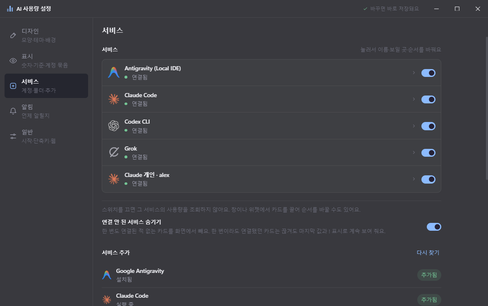

## 9. Tray icon and shortcuts

Clicking the tray icon (single or double click) shows the window and brings it to the front in window mode, or opens and closes the widget in taskbar dock mode. If you've hidden it to the tray, it shows the hidden window or dock again. Right-click it to open the menu.

- Show/hide window or taskbar dock
- Click-through lock
- Open widget
- Settings
- Usage stats
- About & updates (version, automatic updates, release notes)
- 언어 / Language
- Start with Windows
- Refresh now
- Quit

With **Show remaining % on the tray icon** (General tab) on, the tray shows the remaining % of your tightest service even while the window is hidden, and its color changes at the warning and danger levels.

### Global shortcuts (defaults)

| Shortcut | Action |
|---|---|
| `Ctrl+Alt+U` | Show/hide the window or taskbar dock |
| `Ctrl+Alt+L` | Turn Click-through lock on/off |
| `Ctrl+Alt+D` | Cycle through designs |

Combinations already used by another app can't be registered, and a warning shows in the General tab. Click a field and press the combination you want to change it.

### Click-through lock

When locked, clicks on the window go through to the program behind it. Handy when you keep the window over your work. You can't unlock it with the mouse, so use **the shortcut or the tray menu** (floating window only).

### Web page view

Turn on **Settings → General → Web page view** to see your usage in a browser. The page shows the same cards as the window (following your design, theme and accent color) and updates by itself whenever the app checks usage. The page is **view-only**: you can't change settings or request a refresh from it.

- **Open web page**: turns it on and off (off by default). When on, you'll see the address and an **Open in browser** button. On this PC, open `http://localhost:47100/`.
- **Allow other devices**: lets phones and other PCs on the same network (Wi-Fi and so on) connect (off by default = this PC only). When on, this PC's network address (for example `http://192.168.0.10:47100/`) is shown as well. The first time you turn it on, Windows Firewall may ask for permission.
- **Port**: 47100 by default. If another program is using it, Settings will tell you; change it to another number (1024–65535).
- **Access password**: set one of 4 or more characters and the page asks for it before opening. Use **Change** or **Remove password** to change or remove it. Changing the password makes pages that are already open ask for it again. Set a password if you view it from other devices.

## 10. Alerts and usage history

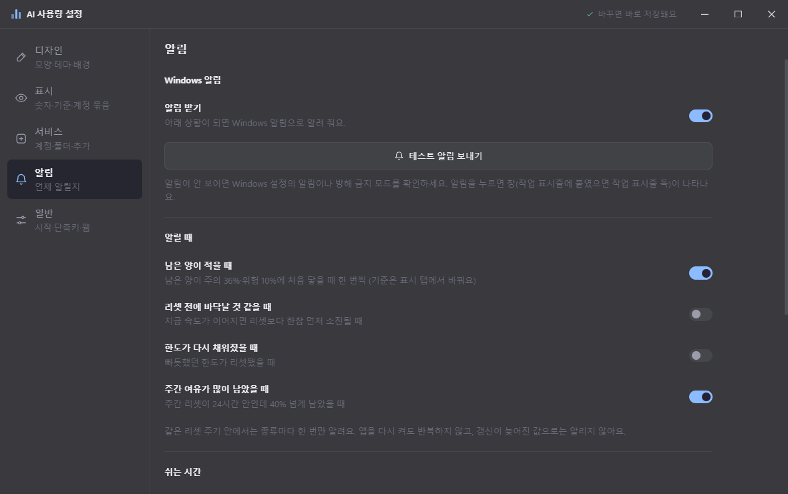

- **Running low**: notifies once each time the remaining amount first reaches the warning or danger level.
- **Expected to run out**: notifies when, at the current rate, a limit looks likely to run out before the reset.
- **Reset** (off by default): notifies when a limit that was tight has been refilled.
- **Weekly room left over**: notifies when the weekly reset is less than 24 hours away and 40% or more is still left.
- **Quiet hours** (Settings → Alerts): no usage notifications during the hours you set (for example 23:00–08:00), and missed ones aren't sent later in a batch.
- Each kind of notification is sent only once per reset period, and restarting the app doesn't repeat it. Clicking a notification shows the window (or the taskbar dock, if docked).
- **Usage history** is recorded on this PC only, every time usage is checked, and kept for 30 days. It feeds "Remaining" in the stats window and the trend line on large cards. Daily usage summaries are kept for a year for the stats.

### Usage stats

Open it from the menu (☰) in the window or widget, **Usage stats** in the tray menu, or **Stats for this service** in a card's right-click menu. It shows a bar chart per service, all measured in **% of the weekly limit** (for example: used 15% of the weekly limit in one day).

- **Daily** (last 30 days), **Weekly** (last 12 weeks, starting Monday), **Monthly** (last 12 months): each bar shows how much was used, along with the total, the average and the busiest bar. The average counts from the first bar that has data. Daily has a "14% a day if spread evenly" reference line and Weekly has a "100% of the weekly limit" line. The rightmost bar (still in progress) is dimmed. Hover over a bar for its date and value.
- **Remaining**: pick a service to see how its 5-hour and weekly remaining % changed over the last 24 hours or 7 days (the "History" tab in older versions).
- **API cost estimate**: the tokens in the logs Claude Code and Codex left on this PC, priced at API list prices. Shows totals for today, the last 7 days, this month and the last 30 days, a 30-day bar per service, and tokens and cost per model. This is not your subscription price, and it's an estimate that leaves out details like long-context surcharges. The first time, it reads all logs, which takes a while (tens of seconds for several GB); after that it only reads what's new. Models not in the price list are shown as "Unknown price" and left out of the totals.
- Usage is counted by adding up each drop in the weekly remaining %. Refills from a reset aren't counted, and usage while the app was off is added to that day the next time it runs. Stats build up from when this feature was added; at first they're filled in from the last 30 days of history that was already recorded.

## 11. Privacy and data locations

- The app **only reads** each service's sign-in information **on this PC**, and uses it to call **only that service's usage endpoint**. Nothing is sent anywhere else, and no usage analytics are collected.
- With **Web page view** on, your usage can be viewed from this PC (or the same network, if other devices are allowed). The page only receives the usage and settings shown on the cards; sign-in information, file paths on this PC and the access password are never sent. The password is stored only as an irreversible hash, never as the original text.
- Claude's model-specific limits and the Grok, Cursor, GitHub Copilot and Gemini CLI usage are read in ways that aren't officially documented. If a service changes its format, only that information disappears and everything else keeps working.
- If the Gemini CLI token has expired, the app gets a new token using the public sign-in values bundled with the Gemini CLI install and uses it **in memory only** (the sign-in file isn't changed). For GitHub Copilot, the token from `gh auth token` is used in memory only.
- The **API cost estimate** takes only token counts per date and model from the Claude Code and Codex logs and stores them in `cost-cache.json` (no conversation content is stored). The price list is the one published by LiteLLM, downloaded once a day to `model-prices.json`.
- Check interval: when the screen is locked or there's been no input for over 10 minutes, checks slow to 4 times your interval (up to 15 minutes), and the app checks again right away when you come back from lock or sleep. If a limit resets before the next check, it checks right after the reset.
- Settings and history files: `%APPDATA%\ai-usage-taskbar-widget\`
  - `config.json`: display and behavior settings
  - `accounts.json`: list of cards (no tokens)
  - `usage-history.json`: usage history
  - `notify-state.json`: notification history

### When new values can't be fetched

If a sign-in ends or the internet drops and new values can't be fetched, cards for services that have connected at least once **don't disappear; they keep showing the last value**. A **Not updated** label appears next to the card name (on small cards, a **!** next to the logo). Hover over it to see what happened, why, what to do, and when the current value was fetched. The label goes away by itself once the connection is back.

Right after the app starts, it shows **the last values it fetched first** so you don't have to wait, with a **Checking** label on each card (on small cards, three blinking dots next to the logo). Each service updates as its new value arrives.

## 12. Troubleshooting

| Problem | Fix |
|---|---|
| A card says "Not connected" | Check that you're signed in to that service's app or CLI. The Services tab in Settings shows each service's status (Connected, Update delayed, Not connected). |
| A Claude card says "Update delayed" | If you restart the app many times in a short period, Claude briefly limits requests. The card keeps the last value and checks again automatically. |
| A Grok card says "expired" | Run `grok` once in a terminal. |
| Antigravity says it can't find the agy CLI | Install the Antigravity CLI, sign in, then restart the app. |
| The window disappeared | Tray icon → Show/hide window or taskbar dock, or `Ctrl+Alt+U`. If clicks don't work, check Click-through lock (`Ctrl+Alt+L`). |
| It won't dock to the taskbar | Let go of the mouse over the taskbar (the very bottom of the screen), while the preview border is showing. Docking is only supported when the taskbar is at the bottom of the screen. |
| Acrylic isn't blurred | Turn on Windows Settings → Personalization → Colors → **Transparency effects**. Before Windows 11 22H2, the background shows through without blur. |
| Not sure whether the app is running | Launch it again from the Start menu and the hidden window will appear. |
| A warning on first launch | See the SmartScreen note in [2. Installation](#2-installation). |

## 13. Updating and uninstalling

- **Automatic updates** (installer version, on by default): checks for a new version every 6 hours, downloads it in the background, and installs it and restarts **every day at 3 AM (by your PC's clock)**. You can change the time under **Settings → General → About** or **Auto-install time** in About & updates. If the PC was asleep at that time and wakes within 2 hours, it installs then; otherwise it waits until the next day. It also installs when you quit the app.
- **"Update" button**: once a new version has been downloaded, an **Update** button appears in the title bar of the window and the widget. Hover over it to see "Install new version ○ and restart"; click it to install and restart right away. If automatic updates are off, download the update with "Check for updates" in About & updates and install it with this button (with automatic updates off, nothing is installed overnight or when you quit).
- **About & updates** window (tray menu, title bar menu ☰, Settings → General → About): click **Check for updates** to see Checking → the result (up to date / downloading / update available) right away. If there's a new version, it shows "current version → new version" and **what's changing in the new version**, and **Update now** installs it straight away. You can also turn automatic updates on or off, set the install time, and see what changed in your current version here.
- **Moving your settings**: under Settings → General → Advanced → **Settings backup**, export your settings and card list to a file and import it on another PC. Sign-in information isn't included.
- **Updating manually**: download the new installer from [Releases](https://github.com/ngnearSINE/ai-usage-widget/releases/latest) and run it to install over the existing version. Your settings and history are kept. The portable (zip) version can only be updated this way.
- **Uninstall**: Windows Settings → Apps → Installed apps → **AI Usage Widget** → Uninstall. The settings and history folder (`%APPDATA%\ai-usage-taskbar-widget\`) stays behind; delete it too for a clean removal.
- For the portable (zip) version, just delete the folder you unzipped.
- **Uninstalling on Ubuntu**: for the deb, `sudo apt remove ai-usage-taskbar-widget`; for the AppImage, delete the file (and `~/.config/autostart/ai-usage-widget.desktop` if you turned on start at login). Settings and history stay in `~/.config/ai-usage-taskbar-widget/`.
