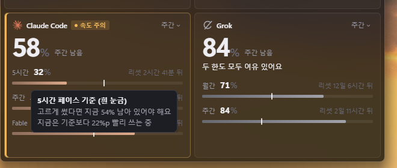
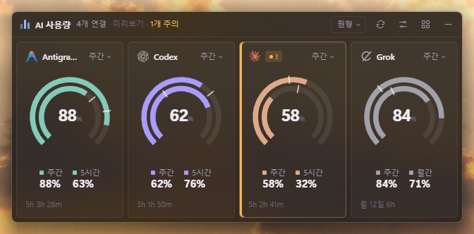
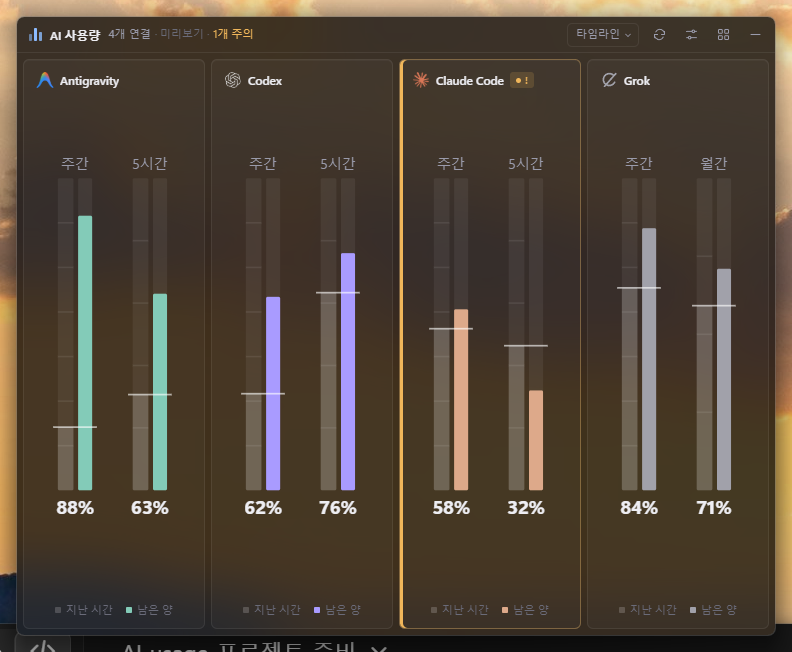
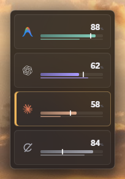
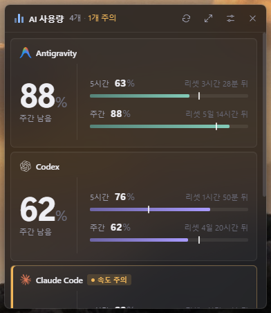
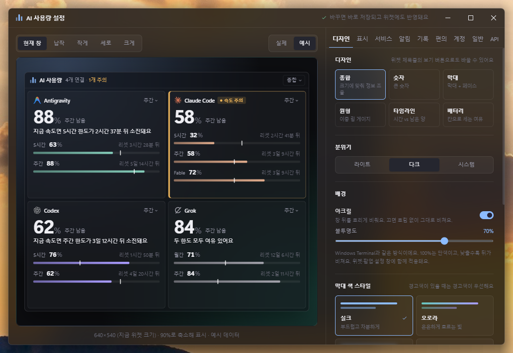
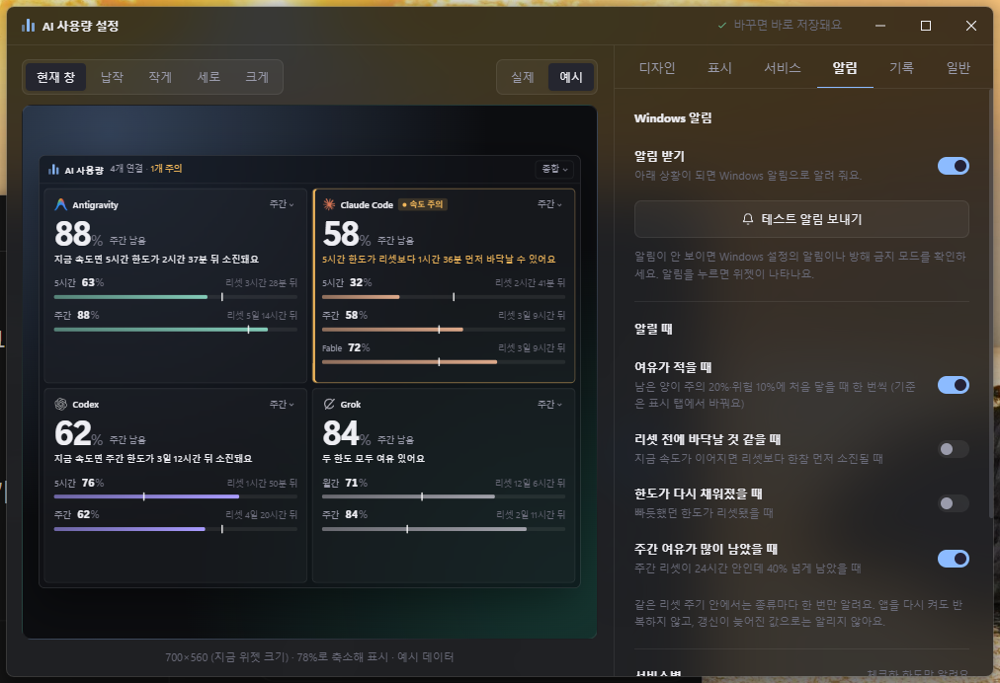

# AI 사용량 위젯 사용 설명서

Claude, Codex(ChatGPT), Antigravity, Grok의 사용 한도(5시간·주간·월간 등)가 얼마나 남았는지 Windows 바탕화면이나 작업 표시줄에서 한눈에 보여 주는 앱입니다. 이 설명서는 처음 쓰는 분을 위해 설치부터 기능까지 순서대로 안내합니다.

> 화면 사진은 모두 실제 계정 대신 예시 데이터로 찍었습니다.

## 목차

1. [준비물](#1-준비물)
2. [설치](#2-설치)
3. [처음 실행했을 때](#3-처음-실행했을-때)
4. [서비스 연결](#4-서비스-연결)
5. [화면 읽는 법](#5-화면-읽는-법)
6. [창 다루기](#6-창-다루기)
7. [작업 표시줄에 붙이기(도킹)](#7-작업-표시줄에-붙이기도킹)
8. [설정 창](#8-설정-창)
9. [트레이 아이콘과 단축키](#9-트레이-아이콘과-단축키)
10. [알림과 사용 기록](#10-알림과-사용-기록)
11. [개인정보와 데이터 위치](#11-개인정보와-데이터-위치)
12. [문제 해결](#12-문제-해결)
13. [업데이트와 제거](#13-업데이트와-제거)

---

## 1. 준비물

- **Windows 11** (x64·arm64, 22H2 이상이면 아크릴 흐림까지 지원). Windows 10에서는 작업 표시줄 도킹·아크릴이 제대로 동작하지 않을 수 있습니다.
- 또는 **Ubuntu** (x64·arm64, 24.04에서 시험). Ubuntu에서는 작업 표시줄 독·위젯·아크릴이 없고 창과 트레이로 씁니다. 자세한 내용은 [Ubuntu에서 쓰기](#ubuntu에서-쓰기)를 보세요.
- 사용량을 보고 싶은 서비스의 **공식 앱이나 CLI에 미리 로그인**되어 있어야 합니다. 앱은 별도 로그인 창이 없고, 이미 로그인된 앱의 정보를 읽기만 합니다. 서비스별 조건은 [4. 서비스 연결](#4-서비스-연결)을 보세요.

## 2. 설치

[Releases](https://github.com/ngnearSINE/ai-usage-widget/releases/latest)에서 내려받습니다. 배포본은 두 가지이고, 하나만 고르면 됩니다.

| 파일 | 설명 |
|---|---|
| `AI-Usage-Widget-Setup-x.y.z.exe` | **설치 파일(추천).** 관리자 권한 없이 내 사용자 폴더(`%LOCALAPPDATA%\Programs\AI Usage Widget`)에 설치하고, 시작 메뉴 바로가기와 제거 기능을 만듭니다. 설치가 끝나면 바로 실행됩니다. |
| `AI-Usage-Widget-x.y.z-win-x64.zip` `AI-Usage-Widget-x.y.z-win-arm64.zip` | **휴대용.** PC에 맞는 쪽(대부분 x64, ARM 노트북은 arm64)을 아무 폴더에나 풀고 `AI Usage Widget.exe`를 실행합니다. 설치·제거 과정이 없습니다. |

설치 파일 하나에 x64·arm64가 함께 들어 있어, 설치할 때 PC에 맞는 쪽이 자동으로 깔립니다.

### "Windows의 PC 보호" 경고가 뜨면

이 앱은 코드 서명 인증서가 없어서, 처음 실행할 때 Windows SmartScreen이 경고를 띄울 수 있습니다. **추가 정보 → 실행**을 누르면 열립니다. 한 번 허용하면 다음부터는 뜨지 않습니다.

### Ubuntu에서 쓰기

`uname -m`이 `x86_64`면 x64(파일 이름의 `x86_64`·`amd64`), `aarch64`면 arm64 파일을 고릅니다.

| 파일 | 설명 |
|---|---|
| `AI-Usage-Widget-x.y.z-linux-x86_64.AppImage` `AI-Usage-Widget-x.y.z-linux-arm64.AppImage` | **추천. 자동 업데이트가 됩니다.** 내려받아 `chmod +x 파일이름`으로 실행 권한을 준 뒤 실행합니다. 실행되지 않으면 `sudo apt install libfuse2t64`(22.04는 `libfuse2`)를 설치하세요. |
| `AI-Usage-Widget-x.y.z-linux-amd64.deb` `AI-Usage-Widget-x.y.z-linux-arm64.deb` | `sudo apt install ./파일이름.deb`으로 설치하고 앱 목록의 **AI 사용량 위젯**으로 실행합니다. 자동 업데이트는 되지 않습니다. |

Windows와 다른 점:
- **작업 표시줄 독·위젯이 없습니다.** 창으로 쓰고, 트레이 아이콘 메뉴로 보이기·숨기기를 합니다(Ubuntu 기본 AppIndicator 확장).
- **아크릴 배경**은 없고 불투명도만 조절합니다.
- **Claude 데스크톱 앱 계정**은 GNOME 키링에 저장된 암호로 읽습니다. 로그인해 키링이 열려 있어야 하고 `python3`가 필요합니다(Ubuntu 데스크톱 기본 설치).
- **Windows를 켤 때 함께 시작**은 Ubuntu에서 '로그인할 때 함께 시작'으로 동작합니다(`~/.config/autostart`).
- 설정·기록은 `~/.config/ai-usage-taskbar-widget/`에 저장합니다.

## 3. 처음 실행했을 때

- 화면 가운데쯤에 창이 나타나고, 작업 표시줄 오른쪽 알림 영역(트레이)에 아이콘이 생깁니다.
- 이 PC에서 로그인된 서비스를 자동으로 찾아 카드로 보여 줍니다. 처음 몇 초는 "확인 중"으로 보일 수 있습니다.
- **Windows를 켤 때 자동으로 실행**되도록 기본 설정되어 있습니다. 원치 않으면 트레이 메뉴의 "윈도우 시작 시 자동 실행"을 끄세요.
- 창 닫기 단추 대신 `—`(트레이로 숨기기)가 있습니다. 완전히 끄려면 트레이 아이콘 메뉴의 **종료**를 누릅니다.

## 4. 서비스 연결

앱은 각 서비스의 **공식 앱·CLI가 이 PC에 남긴 로그인 정보를 읽기만** 합니다. 로그인 정보를 새로 만들지 않습니다. **예외 하나**: Claude Code CLI 토큰(8시간짜리)이 만료되고 10분이 지나도록 아무도 갱신하지 않으면, 앱이 CLI와 같은 방식(같은 잠금·주소·형식)으로 대신 갱신해 CLI 로그인 파일에 다시 저장합니다. 쓰는 중인 유효한 토큰은 건드리지 않습니다. 로그인 기간(약 한 달)이 끝나면 터미널에서 `claude`로 다시 로그인해야 합니다.

| 서비스 | 필요한 것 | 보여 주는 한도 |
|---|---|---|
| **Claude** | Claude Code CLI(`claude`) 또는 Claude 데스크톱 앱 중 하나 이상 로그인 | 5시간, 주간, 모델 전용 주간 한도(예: 팀 요금제의 Fable) |
| **Codex / ChatGPT** | Codex CLI, Codex 데스크톱 앱, VS Code·Windsurf의 ChatGPT 확장 중 하나 로그인 | 5시간, 주간(요금제에 따라 주간만) |
| **Antigravity** | Antigravity CLI(`agy`) 설치·로그인 | 5시간, 주간 |
| **Grok** | Grok CLI(`grok`) 로그인 | 주간, 월간 크레딧(있는 요금제만) |

### Claude 팀·개인 계정이 여러 개일 때

Claude는 한 이메일이 여러 **조직**(팀, 개인)에 속할 수 있고, 한도는 조직마다 따로입니다. 앱은 CLI와 데스크톱 앱에 있는 로그인을 모두 찾아 조직마다 카드를 하나씩 만듭니다.

- 카드 이름은 "Claude 팀 · 조직 이름", "Claude 개인 · 이메일 앞부분" 형식입니다. 설정 창 **서비스** 탭에서 그 서비스를 눌러 이름을 바꿀 수 있습니다.
- 한 번 뺀 조직 카드는 자동으로 다시 생기지 않습니다. 다시 보려면 서비스 탭 **고급 → 기본 서비스 목록으로 되돌리기**를 쓰세요.

### 알아 두면 좋은 점

- **두 번째 계정(Codex·Grok)**: 평소 계정과 다른 폴더에 로그인해 두고(명령 프롬프트에서 `set CODEX_HOME=폴더` 다음에 `codex login`, Grok은 `set GROK_HOME=폴더` 다음에 `grok login`), 설정 → 서비스 → **다른 로그인 폴더의 계정 추가**에서 그 폴더를 고릅니다. Antigravity는 로그인을 폴더로 나눌 수 없어 지원하지 않습니다.
- **Claude Code CLI**로만 연결된 조직은 CLI를 몇 시간 쓰지 않으면 로그인이 만료됩니다. 카드에 "CLI 로그인이 … 만료됐어요"가 뜨면 터미널에서 `claude`를 한 번 실행하세요. 그동안 마지막 값을 '갱신 지연'으로 보여 줍니다.
- **Grok**은 로그인 토큰이 몇 시간마다 만료됩니다. 카드에 "만료" 안내가 뜨면 터미널에서 `grok`을 한 번 실행하면 갱신됩니다.
- **Claude** 데스크톱 앱에서 쓰지 않는 조직의 카드는 오래 지나면 "갱신 지연"이 될 수 있습니다. 앱에서 그 조직으로 한 번 전환하면 다시 살아납니다.
- Codex 실행 파일을 찾지 못하면 환경 변수 `CODEX_EXECUTABLE`에 `codex.exe` 경로를 지정하세요.

## 5. 화면 읽는 법

### 카드

- **큰 숫자**: 기준 한도(기본 주간)의 남은 양입니다. 카드 오른쪽 위 `주간 ▾`를 눌러 5시간·주간·빠듯한 쪽 중에서 고를 수 있습니다.
- **막대**: 색칠된 길이가 남은 양입니다.
- **흰 세로 눈금(페이스)**: 리셋 주기 동안 고르게 썼다면 지금쯤 남아 있어야 할 위치입니다. 막대 끝이 눈금보다 **오른쪽**이면 여유 있게, **왼쪽**이면 빨리 쓰는 중입니다.
- **사용량에 따른 막대 색상 변경**: 남은 양에 따라 막대와 % 숫자의 색이 바뀝니다. 설정 → 표시의 그라데이션 띠에서 PPT 그라데이션처럼 **색 점**의 위치(남은 양 %)와 색(서비스 색·주황·빨강·직접 고른 색)을 정합니다. 점을 끌어 옮기고, 띠의 빈 곳을 누르면 점이 늘어납니다(최대 8개, 휴지통 단추로 지움). 기본은 50%까지 서비스 색, 20%에서 주황, 10% 아래 빨강입니다. **부드럽게 바뀌기**(기본)는 점 사이를 섞고, **한 번에 바뀌기**는 남은 양이 점 위치에 닿는 순간 그 색이 됩니다. 숫자에서 '서비스 색' 자리는 평소 글씨색(다크·라이트 테마에 맞춤)입니다. 모든 디자인(원형·배터리 등)과 작업 표시줄 독에 똑같이 적용됩니다. 평소 색은 서비스 탭에서 서비스마다 서비스 색·초록·직접 고른 색 중에 정합니다.
- **주황 테두리와 "속도 주의"**: 남은 양이 기준 아래이거나, 지금 속도면 리셋 전에 바닥날 것으로 보이는 카드입니다.
- 작은 카드에서는 막대 아래의 **가는 보조 막대**가 다른 한도(보통 5시간)를 나타냅니다.

### 마우스를 올리면

막대·눈금·카드에 마우스를 올리면 그 요소가 무엇인지, 남은 양, 리셋까지 남은 시간과 리셋 시각, 소진 예상 같은 설명이 뜹니다. 작은 창에서 생략된 정보도 여기서 볼 수 있습니다.

### 디자인 6가지

창·위젯 제목줄의 메뉴(☰)나 설정 창에서 바꿉니다.

| 디자인 | 특징 |
|---|---|
| 종합 | 크기에 맞춰 큰 숫자·상태 문장·두 한도 막대·24시간 추이선까지 조절 |
| 숫자 | 큰 숫자 위주 |
| 막대 | 한도별 막대 + 페이스 눈금 |
| 원형 | 바깥 링 주간, 안쪽 링 5시간 |
| 타임라인 | 지난 시간과 남은 양을 나란히 비교 |
| 배터리 | 칸 수로 세는 여유 |

| 막대 | 원형 | 타임라인 |
|---|---|---|
|  |  |  |

## 6. 창 다루기

- **옮기기**: 제목줄을 끌어 옮깁니다.
- **크기 바꾸기**: 가장자리나 모서리를 끌어 바꿉니다. 카드 배치와 정보량은 크기에 맞춰 자동으로 바뀌고, 스크롤은 생기지 않습니다(너무 작으면 페이지로 나뉩니다).
- **아주 작게**: 서비스가 하나면 약 170×64까지 줄일 수 있습니다. 창이 좁거나 낮으면 제목줄이 숨겨지고, **창 위쪽 가장자리에 마우스를 올리면** 나타납니다.
- **카드 순서**: 카드가 한 장뿐이면(집중 모드 포함) 카드를 끌어도 제목줄처럼 창 전체가 움직입니다. 여러 장이면 카드를 누른 채 끌면 다른 카드가 비켜서 들어갈 자리를 보여 주고, 놓은 자리에 그대로 들어갑니다. 우클릭 메뉴의 **앞으로·뒤로 옮기기**나 설정 → 서비스에서도 바꿀 수 있습니다. "여유가 적은 서비스를 앞으로"가 켜져 있으면 순서를 바꿀 수 없습니다.
- **CLI·앱 바로 열기**: 카드를 **Ctrl+두 번 클릭**하면 그 서비스의 CLI(claude·codex·grok·agy)가 기본 터미널에서 실행되고, **Shift+두 번 클릭**하면 데스크톱 앱(Claude·ChatGPT/Codex·Grok 등)이 열립니다. 우클릭 메뉴의 'CLI 열기'·'앱 열기'도 같습니다. 이 PC에서 찾지 못하면 메뉴가 흐리게 보이고, **설정 → 서비스**에서 그 서비스를 펼쳐 '직접 고르기…'로 실행 파일이나 바로 가기를 지정할 수 있습니다('자동으로'를 누르면 다시 자동 찾기). 같은 곳의 **CLI 시작 폴더**에서 CLI를 열 폴더를 고를 수 있습니다(기본은 홈 폴더, '홈 폴더로'로 되돌림).
- **우클릭 메뉴**: 카드를 우클릭하면 새로고침, 공식 사용량 페이지, 큰 숫자 기준, 보여 줄 정보(그 카드만), 순서 옮기기, 숨기기, 서비스 설정이 나옵니다.
- **숫자키 1~5**: 창(또는 위젯) 크기를 아주 작게(1)부터 아주 크게(5)까지 한 번에 바꿉니다.
- **Ctrl+1~6**: 디자인을 바꿉니다(1 종합, 2 숫자, 3 막대, 4 원형, 5 타임라인, 6 배터리).
- **제목줄**: 가운데에 현재 시각이 보입니다(미리보기 앱이면 `13:38 (미리보기)`처럼 붙고, 창이 좁아 왼쪽 문구와 겹치면 숨김). 왼쪽에는 연결 수와 주의 수가 보이고, 마지막·다음 갱신 시각은 새로고침 단추에 마우스를 올리면 보입니다. 오른쪽 단추는 핀·새로고침·설정·메뉴·숨기기 순서입니다.
- **메뉴(☰) 단추**: 제목줄의 설정 단추 오른쪽에 있습니다. 디자인 바꾸기, 설정, 사용량 통계, 정보·업데이트, 트레이로 숨기기, 종료가 들어 있습니다.
- **집중 모드**: 카드를 두 번 누르거나 우클릭 메뉴 맨 위 **집중 모드**를 고르면 그 서비스 하나만 보입니다(창·작업 표시줄 독·위젯 모두). 카드 한 장으로 취급해 창을 한 장 크기까지 줄일 수 있습니다. 제목줄은 위쪽 가장자리에 마우스를 올릴 때만 나타나고, Esc(위젯에서는 Esc가 위젯을 닫음)·제목줄의 **집중** 칩·다시 두 번 누르기로 풀립니다. 앱을 다시 켜면 풀린 상태로 시작합니다.
- **항상 위 핀**: 제목줄의 핀 단추로 항상 위에 표시를 켜고 끕니다(기본 켜짐).
- **경고 배경**(배경 칠하기): 막대 색과 같은 색 점을 따라 카드 배경이 은은하게 칠해집니다. '서비스 색' 자리는 투명이라 여유가 있을 때는 칠하지 않습니다. 설정 → 표시의 '사용량에 따른 막대 색상 변경' 아래에서 끄거나, **세기**(0~100% 슬라이더, 기본 30%. 높일수록 진해지고 100%면 기본의 3배쯤), **퍼짐**(0~100%, 기본 30%. 높일수록 진한 곳에서 더 넓게 번지고 카드 전체에 옅은 바탕이 깔림)와 **진한 곳**(테두리·가운데·한쪽)을 고릅니다. '한쪽'을 고르면 카드 모양의 방향 고르기가 나타나 위·아래·왼쪽·오른쪽·네 모서리 중 하나를 고릅니다. **기본값으로** 단추를 누르면 세기·퍼짐·진한 곳이 처음 값(30%·30%·테두리)으로 돌아갑니다.
- **공식 사용량 페이지**: 카드 우클릭 메뉴에서 엽니다(Claude·Codex·Grok).
- **새로고침**: 제목줄의 ⟳ 단추 또는 트레이 메뉴 "지금 새로고침". 자동 조회 주기는 기본 1분입니다(설정 창 일반 탭에서 15초~5분).

## 7. 작업 표시줄에 붙이기(도킹)

1. 창 제목줄을 잡고 **화면 맨 아래 작업 표시줄 위로** 끌어옵니다.
2. 작업 표시줄의 실제 들어갈 자리에 **작업 표시줄 독 모양 미리보기**(강조색 테두리)가 나타납니다.
3. 마우스를 놓으면 그 자리로 줄어들며 붙습니다. 작업 표시줄에 붙은 이 띠를 **작업 표시줄 독**이라고 부릅니다.

- **붙은 상태에서 끌면** 작업 표시줄 안에서 좌우로만 움직이고, 놓은 자리를 기억합니다.
- **위로 40px 넘게 끌어 올리면** 다시 원래 크기의 창이 됩니다.
- 작업 표시줄 독을 한 번 누르면 **위젯**이 맨 앞에 열립니다. **두 번 누르면** 작업 표시줄에 붙은 채로 그 카드 하나만 보는 집중 모드가 켜지고, 다시 두 번 누르면 꺼집니다(넓어져도 시계는 가리지 않음). 위젯은 창과 똑같습니다. 같은 디자인·카드 배치·제목줄 단추·메뉴를 쓰고, 카드를 끌어 순서를 바꾸며, 카드가 한 장이면(집중 모드 포함) 카드를 끌어 위젯을 옮깁니다. 다른 점은 두 가지입니다. 오른쪽 위 단추가 트레이로 숨기기 대신 **닫기**(✕)이고, **Esc**를 누르면 위젯이 닫힙니다. 제목줄을 끌어 옮기고 가장자리를 끌어 크기를 바꾸면 그 위치·크기를 기억합니다.
- 시계·알림 영역은 덮지 않도록 그 왼쪽까지만 갑니다. 고정된 앱 아이콘 위에 놓으면 그 아이콘은 가려집니다.
- 설정 창 **표시** 탭의 "작업 표시줄에 붙이기" 단추로도 붙일 수 있습니다.
- 작업 표시줄에는 일부 서비스만 두고 싶다면 서비스 탭에서 그 서비스를 눌러 **보일 곳 → 창·위젯만**을 고르세요(창과 위젯에는 그대로 보입니다).

## 8. 설정 창

창·위젯 제목줄의 설정 단추(슬라이더 모양)나 트레이 메뉴 **설정**으로 엽니다. 마지막으로 보던 탭이 열립니다. 바꾸면 바로 저장되고 창·위젯에 반영됩니다. 왼쪽에는 지금 설정이 적용된 미리보기가 보이고, 크기(현재 창·납작·작게·세로·크게)와 데이터(실제·예시)를 바꿔 볼 수 있습니다.

| 탭 | 하는 일 |
|---|---|
| **디자인** | 디자인 6종, 테마(라이트·다크·시스템), **배경**(아크릴 켬/끔 + 불투명도), 막대 색, 강조색, 서비스 아이콘(브랜드 색·단색), 스케일·카드 간격, 움직임 |
| **표시** | 큰 숫자 기준, 주의·위험 기준(남은 %), **사용량에 따른 막대 색상 변경**(제목 옆 스위치로 켜고 끔, 한 번에·부드럽게 바뀌기, 색 점 그라데이션, 같은 색 점으로 배경 칠하기), 여유가 적은 서비스를 앞으로, **보여 줄 정보 표**(쓴 양으로·예상 시간·리셋 시간을 서비스별로, 맨 윗줄은 모든 서비스에 한 번에. **예상 시간**을 끄면 페이스 눈금·속도 칩·'○ 후 소진(예상)'·속도 주의가 모두 빠지고 남은 양만 봅니다. **리셋 시간**을 끄면 리셋까지 남은 시간과 시각이 빠집니다), 항상 위에 표시, 작업 표시줄에 붙이기 |
| **서비스** | 서비스 목록(스위치로 조회 켜기·끄기). 서비스를 누르면 이름, **보일 곳**(모두·창·위젯만·숨김), **평소 색**(서비스 색·초록·직접 고르기), Fable 등 모델 전용 한도 표시, 순서, 목록에서 빼기. 아래에서 이 PC의 로그인 찾아 추가, 숫자를 직접 넣는 카드 추가, **다른 로그인 폴더의 계정 추가**(Codex·Grok) |
| **알림** | Windows 알림 켜기, 알릴 조건, 서비스·한도별 끄기, 테스트 알림, **쉬는 시간** |
| **일반** | Windows 시작 시 실행, 사용량 확인 간격, 트레이 숫자, 클릭 통과 잠금, 단축키, **웹 페이지로 보기**, 정보·업데이트 창 열기, 사용 설명서. **고급**: 모니터 구성별 배치, 작업 표시줄 독 세부 설정, **설정 백업·복원** |

자주 쓰지 않는 항목은 탭 아래쪽 **고급**을 눌러 펼치면 보입니다.

### 배경(불투명도와 아크릴)

Windows Terminal과 같은 방식입니다. **불투명도**가 100%면 단색, 낮출수록 뒤가 비칩니다. **아크릴**을 켜면 비치는 뒤를 흐리게, 끄면 흐림 없이 그대로 비춥니다. 창·위젯·설정 창에 함께 적용됩니다.

**배경 색**은 '고르지 않음'(기본)이면 테마(라이트·다크)에 맞춰 바뀝니다. 색을 고르면(어두운 색 4가지·밝은 색 2가지·직접 고르기) 배경은 그 색 그대로 두고 글씨색만 테마를 따릅니다. 밝은 색에는 라이트, 어두운 색에는 다크 테마가 잘 읽힙니다. 작업 표시줄 독은 작업 표시줄 색을 따르므로 배경 색이 적용되지 않습니다.

### 스케일

**설정 → 디자인 → 크기와 간격**의 **스케일**(80~150%, 기본 100%)은 화면을 통째로 확대·축소합니다. 글자만이 아니라 카드·아이콘·간격이 함께 커지고 작아지며, 창·위젯·설정·정보 창에 모두 적용됩니다.

- 창 크기도 같은 비율로 바뀌어 카드 배치는 그대로입니다. 예를 들어 100%에서 120%로 올리면 창도 1.2배가 됩니다.
- 슬라이더는 처음 누른 자리에서 움직인 만큼만 바뀝니다. 끄는 동안 왼쪽 미리보기가 같은 배치로 커지거나 작아지고, 손을 떼면 창에 적용됩니다. 미리보기 아래 줄에 그 스케일에서의 실제 창 크기가 나옵니다.
- 작업 표시줄 독은 작업 표시줄 높이에 맞춰야 하므로 스케일과 상관없이 그대로입니다.

## 9. 트레이 아이콘과 단축키

트레이 아이콘을 누르면 메뉴가 열립니다.

- 창·작업 표시줄 독 표시/숨김
- 클릭 통과 잠금
- 위젯 열기
- 설정
- 사용량 통계
- 정보·업데이트(버전, 자동 업데이트, 변경 내역)
- Windows를 켤 때 함께 시작
- 지금 새로고침
- 종료

**트레이 아이콘에 남은 % 표시**(일반 탭)를 켜 두면 창을 숨겨도 가장 빠듯한 서비스의 남은 %가 트레이에 보이고, 주의·위험이면 색이 바뀝니다.

### 전역 단축키(기본값)

| 단축키 | 동작 |
|---|---|
| `Ctrl+Alt+U` | 창·작업 표시줄 독 보이기/숨기기 |
| `Ctrl+Alt+L` | 클릭 통과 잠금/해제 |
| `Ctrl+Alt+D` | 디자인 순환 |

다른 앱이 이미 쓰는 조합은 등록되지 않고, 일반 탭에 경고가 뜹니다. 칸을 누르고 원하는 조합을 눌러 바꿀 수 있습니다.

### 클릭 통과 잠금

잠그면 창 위를 클릭해도 그 뒤의 프로그램이 눌립니다. 창을 화면 위에 띄워 두고 작업할 때 편합니다. 마우스로는 풀 수 없으므로 **단축키나 트레이 메뉴**로 풉니다(자유 창에서만 동작).

### 웹 페이지로 보기

**설정 → 일반 → 웹 페이지로 보기**를 켜면 브라우저로 사용량을 볼 수 있습니다. 페이지는 창과 같은 카드 화면이고(디자인·테마·강조색을 그대로 따름), 앱이 사용량을 새로 확인할 때마다 저절로 바뀝니다. 페이지에서는 **보기만** 할 수 있고 설정을 바꾸거나 새로고침을 요청할 수는 없습니다.

- **웹 페이지 열기**: 켜고 끕니다(기본 꺼짐). 켜면 접속 주소와 **브라우저로 열기** 단추가 보입니다. 이 PC에서는 `http://localhost:47100/`으로 엽니다.
- **다른 기기에서도 보기**: 같은 네트워크(와이파이 등)의 휴대폰·다른 PC에서 접속할 수 있게 합니다(기본 꺼짐 = 이 PC에서만). 켜면 이 PC의 네트워크 주소(예: `http://192.168.0.10:47100/`)가 함께 보입니다. 처음 켤 때 Windows 방화벽 허용 창이 뜰 수 있습니다.
- **포트**: 기본 47100입니다. 다른 프로그램이 쓰고 있으면 설정에 안내가 뜨니 다른 번호(1024~65535)로 바꾸세요.
- **접속 암호**: 4자 이상으로 정하면 페이지를 열 때 먼저 암호를 묻습니다. **바꾸기**·**암호 없애기**로 바꾸거나 없앱니다. 암호를 바꾸면 열려 있던 페이지도 다시 암호를 묻습니다. 다른 기기에서 볼 때는 암호를 정해 두세요.

## 10. 알림과 사용 기록

- **여유 부족**: 남은 양이 주의·위험 기준에 처음 닿을 때 한 번씩 알립니다.
- **소진 예상**: 지금 속도면 리셋 전에 바닥날 것 같을 때 알립니다.
- **리셋**(기본 꺼짐): 빠듯했던 한도가 새로 채워졌을 때 알립니다.
- **남는 주간 여유**: 주간 리셋이 24시간 안인데 40% 이상 남았을 때 알립니다.
- **쉬는 시간**(설정 → 알림): 정한 시간대(예: 23:00~08:00)에는 사용량 알림을 보내지 않고, 지난 알림을 나중에 몰아 보내지도 않습니다.
- 같은 리셋 주기 안에서는 종류마다 한 번만 알리고, 앱을 다시 켜도 반복하지 않습니다. 알림을 누르면 창(작업 표시줄에 붙였으면 작업 표시줄 독)이 나타납니다.
- **사용 기록**은 조회할 때마다 이 PC에만 쌓이고 30일 동안 보관합니다. 통계 창의 '남은 양'과 큰 카드의 추이선에 쓰입니다. 날짜별 사용량 요약은 통계용으로 1년 동안 보관합니다.

### 사용량 통계

창·위젯의 메뉴(☰), 트레이 메뉴의 **사용량 통계**, 또는 카드 우클릭 **이 서비스 통계**로 엽니다. 서비스마다 막대그래프로 보여 주고, 단위는 모두 **주간 한도의 %**입니다(예: 하루에 주간 한도를 15% 썼다).

- **일간**(최근 30일)·**주간**(최근 12주, 월요일 시작)·**월간**(최근 12달): 칸마다 쓴 양과 함께 합계·평균·가장 많이 쓴 칸을 보여 줍니다. 평균은 기록이 처음 생긴 칸부터 셉니다. 일간에는 '고르게 쓰면 하루 14%', 주간에는 '주간 한도 100%' 기준선이 있습니다. 맨 오른쪽(지금 진행 중인 칸)은 흐리게 보입니다. 막대에 마우스를 올리면 날짜와 값이 보입니다.
- **남은 양**: 서비스 하나를 골라 최근 24시간·7일 동안의 5시간·주간 남은 %가 어떻게 바뀌었는지 봅니다(예전 설정의 '기록' 탭).
- 쓴 양은 주간 남은 %가 줄어든 만큼을 더해 셉니다. 리셋으로 다시 차오른 양은 빼고, 앱이 꺼져 있던 동안 쓴 양은 다음에 켤 때 그날로 들어갑니다. 통계는 이 기능이 생긴 뒤부터 쌓이고, 처음에는 남아 있던 최근 30일 기록으로 채웁니다.

## 11. 개인정보와 데이터 위치

- 앱은 각 서비스의 로그인 정보를 **이 PC 안에서 읽기만** 하고, 그 정보로 **각 서비스의 사용량 조회 주소에만** 요청합니다. 다른 곳으로 보내지 않고, 사용 통계도 수집하지 않습니다.
- **웹 페이지로 보기**를 켜면 이 PC(다른 기기 접속을 켰으면 같은 네트워크)에서 사용량을 볼 수 있습니다. 페이지로는 카드에 보이는 사용량·설정만 보내고, 로그인 정보·이 PC의 파일 경로·접속 암호는 보내지 않습니다. 암호는 원래 글자 대신 바꿀 수 없는 형태(해시)로만 저장합니다.
- Claude 모델 전용 한도와 Grok 사용량은 공식 문서에 없는 조회 방식입니다. 서비스 쪽에서 형식이 바뀌면 그 정보만 빠지고, 나머지는 계속 표시됩니다.
- 설정·기록 파일 위치: `%APPDATA%\ai-usage-taskbar-widget\`
  - `config.json`: 화면·동작 설정
  - `accounts.json`: 카드 목록(토큰 없음)
  - `usage-history.json`: 사용 기록
  - `notify-state.json`: 알림 기록

### 새 값을 받지 못할 때

로그인이 끝나거나 인터넷이 끊겨 새 값을 받지 못해도, 한 번이라도 연결됐던 서비스의 카드는 **사라지지 않고 마지막 값을 그대로** 보여 줍니다. 대신 카드 이름 옆에 **갱신 안 됨**(작은 카드는 로고 옆 **!**) 표시가 붙습니다. 마우스를 올리면 무슨 일인지, 왜 그런지, 어떻게 하면 되는지와 지금 값을 언제 받았는지 알려 줍니다. 다시 연결되면 표시는 저절로 사라집니다.

앱을 막 켰을 때는 기다리지 않도록 **마지막으로 받은 값을 먼저** 보여 주고, 카드에 **확인 중**(작은 카드는 로고 옆에 깜박이는 점 세 개) 표시를 붙입니다. 서비스마다 새 값이 오는 대로 하나씩 바뀝니다.

## 12. 문제 해결

| 증상 | 해결 |
|---|---|
| 카드가 "연결 안 됨" | 해당 서비스의 앱·CLI에 로그인되어 있는지 확인하세요. 설정 → 서비스 탭에서 서비스마다 상태(연결됨·갱신 지연·연결 안 됨)를 볼 수 있습니다. |
| Claude 카드가 "갱신 지연" | 짧은 시간에 앱을 여러 번 다시 켜면 Claude가 잠시 요청을 제한합니다. 마지막 값을 유지하다가 자동으로 다시 조회합니다. |
| Grok 카드에 "만료" | 터미널에서 `grok`을 한 번 실행하세요. |
| Antigravity "agy CLI를 찾을 수 없습니다" | Antigravity CLI를 설치하고 로그인한 뒤 앱을 다시 켜세요. |
| 창이 사라짐 | 트레이 아이콘 → 창·작업 표시줄 독 표시/숨김, 또는 `Ctrl+Alt+U`. 클릭이 안 되면 클릭 통과 잠금(`Ctrl+Alt+L`)을 확인하세요. |
| 작업 표시줄에 붙지 않음 | 마우스를 작업 표시줄 위(화면 맨 아래)에서 놓아야 합니다. 미리보기 테두리가 보일 때 놓으세요. 작업 표시줄이 화면 아래쪽에 있을 때만 지원합니다. |
| 아크릴이 흐리지 않음 | Windows 설정 → 개인 설정 → 색 → **투명 효과**를 켜세요. Windows 11 22H2 미만에서는 흐림 없이 비칩니다. |
| 앱이 실행 중인지 모르겠음 | 시작 메뉴에서 다시 실행하면 숨어 있던 창이 나타납니다. |
| 처음 실행 때 경고 | [2. 설치](#2-설치)의 SmartScreen 안내를 보세요. |

## 13. 업데이트와 제거

- **자동 업데이트**(설치판, 기본 켜짐): 6시간마다 새 버전을 확인해 뒤에서 내려받고, **매일 새벽 3시(PC 시계 기준)**에 설치하고 다시 시작합니다. 시각은 **설정 → 일반 → 정보**나 정보·업데이트 창의 **자동 설치 시각**에서 바꿀 수 있습니다. 그 시각에 PC가 잠자기였다가 2시간 안에 깨어나면 그때 설치하고, 지나면 다음 날로 미룹니다. 앱을 끌 때도 설치됩니다.
- **'업데이트' 단추**: 새 버전을 받아 두면 창과 위젯의 제목줄에 **업데이트** 단추가 생깁니다. 마우스를 올리면 "새 버전 ○ 설치하고 다시 시작"이 뜨고, 누르면 바로 설치하고 다시 시작합니다. 자동 업데이트를 꺼 두었으면 정보·업데이트 창에서 '업데이트 확인'으로 받은 뒤 이 단추로 설치합니다(끄면 새벽 설치·종료 시 설치를 하지 않습니다).
- **정보·업데이트** 창(트레이 메뉴, 제목줄 메뉴 ☰, 설정 → 일반 → 정보): **업데이트 확인**을 누르면 확인 중 → 결과(최신 버전 / 받는 중 / 업데이트 가능)가 바로 보입니다. 새 버전이 있으면 '지금 버전 → 새 버전'과 **새 버전에서 바뀌는 점**을 보여 주고, **지금 업데이트**로 바로 설치할 수 있습니다. 자동 업데이트 켜기·끄기, 설치 시각, 지금 버전에서 바뀐 점도 여기서 봅니다.
- **설정 옮기기**: 설정 → 일반 → 고급 → **설정 백업**에서 설정과 카드 목록을 파일로 내보내고, 다른 PC에서 불러올 수 있습니다. 로그인 정보는 담지 않습니다.
- **직접 업데이트**: [Releases](https://github.com/ngnearSINE/ai-usage-widget/releases/latest)에서 새 설치 파일을 내려받아 실행하면 기존 설치를 덮어씁니다. 설정과 기록은 유지됩니다. 휴대용(zip)은 이 방법으로만 업데이트됩니다.
- **제거**: Windows 설정 → 앱 → 설치된 앱 → **AI Usage Widget** → 제거. 설정·기록 파일(`%APPDATA%\ai-usage-taskbar-widget\`)은 남으니, 깨끗이 지우려면 그 폴더도 지우세요.
- 휴대용(zip)은 압축을 푼 폴더를 지우면 됩니다.
